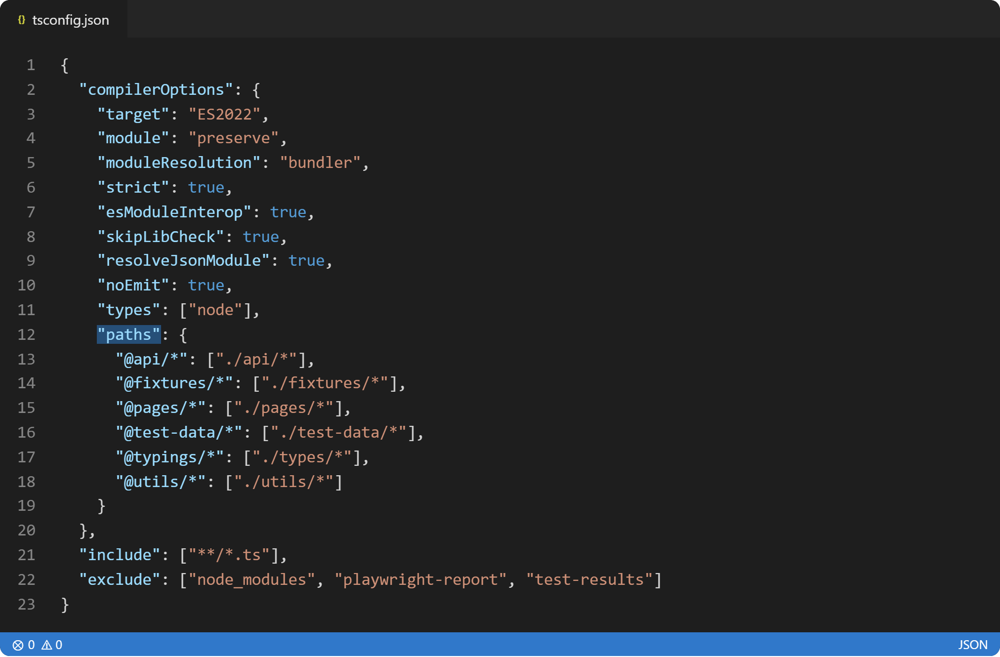

# Buổi 9 · playwright.config.ts & Điều khiển việc chạy test

Khi bộ test lớn dần, cần kiểm soát được cách bộ test chạy: chạy nhanh, đủ thông tin để phân tích khi test fail và chỉ chạy những test cần thiết. Buổi này trình bày các công cụ Playwright cung cấp cho việc đó.

## 1. Cấu trúc playwright.config.ts

File `playwright.config.ts` được tạo ở thư mục gốc project khi chạy `npm init playwright@latest` ở Buổi 4. Mọi lệnh `npx playwright test` đều đọc file này trước khi chạy test. Sau khi bổ sung `testIdAttribute` ở Buổi 5, phần nạp `.env` ở Buổi 8 và chỉ giữ lại project `chromium` (xem mục tiếp theo), nội dung file tương tự đoạn sau (đã lược bớt comment):

```typescript
import { defineConfig, devices } from "@playwright/test";
import dotenv from "dotenv";
import path from "path";

dotenv.config({ path: path.resolve(__dirname, ".env") });

export default defineConfig({
  testDir: "./tests",
  fullyParallel: true,
  forbidOnly: !!process.env.CI,
  retries: process.env.CI ? 2 : 0,
  workers: process.env.CI ? 1 : undefined,
  reporter: "html",
  use: {
    baseURL: process.env.BASE_URL || "https://practicesoftwaretesting.com",
    testIdAttribute: "data-test",
    trace: "on-first-retry",
  },
  projects: [
    { name: "chromium", use: { ...devices["Desktop Chrome"] } },
  ],
});
```

| Thiết lập             | Ý nghĩa                                                                                                         |
| --------------------- | --------------------------------------------------------------------------------------------------------------- |
| `defineConfig({...})` | Hàm bọc object cấu hình, giúp VS Code gợi ý tên thiết lập và báo lỗi khi gõ sai                                 |
| `testDir`             | Folder chứa file test. Playwright chỉ tìm file có tên kết thúc bằng `.spec.ts` hoặc `.test.ts` trong folder này |
| `fullyParallel`       | `true`: các test trong cùng một file cũng được chạy song song                                           |
| `forbidOnly`          | Báo lỗi nếu code còn `test.only` khi chạy trên CI                                                       |
| `retries`             | Số lần chạy lại một test bị fail                                                                        |
| `workers`             | Số process chạy test đồng thời. `undefined` nghĩa là để Playwright tự chọn theo cấu hình máy            |
| `reporter`            | Định dạng báo cáo kết quả. `"html"` tạo HTML report, mở bằng `npx playwright show-report` (Buổi 4)              |
| `use`                 | Thiết lập áp dụng cho mọi test: địa chỉ gốc, thuộc tính test id, screenshot, video, trace...                    |
| `projects`            | Danh sách cấu hình chạy. Mỗi project chạy toàn bộ test một lần với thiết lập riêng                      |
| `devices`             | Danh sách cấu hình trình duyệt có sẵn của Playwright. `...` (spread operator) sao chép toàn bộ thuộc tính của `devices["Desktop Chrome"]` vào khối `use` của project |

Trong khối `use`, `baseURL` là địa chỉ gốc được ghép với đường dẫn tương đối trong `page.goto("/auth/login")` và `toHaveURL()` (Buổi 8). `testIdAttribute` là thuộc tính mà `getByTestId()` sử dụng (Buổi 5). Tên thiết lập phân biệt chữ hoa và chữ thường: viết `baseUrl` thay cho `baseURL` thì thiết lập không có hiệu lực, và `goto()` với đường dẫn tương đối báo lỗi `Cannot navigate to invalid URL`.

### Biến môi trường CI

**CI** (Continuous Integration) là hệ thống tự động chạy test mỗi khi có code mới được push lên repository, ví dụ GitHub Actions, GitLab CI. Các hệ thống này tự đặt biến môi trường `CI`. Biểu thức `process.env.CI ? 2 : 0` đọc biến môi trường đó (`process.env` đã học ở Buổi 8). Toán tử `!!` chuyển một giá trị bất kỳ thành `true` hoặc `false`.

| Thiết lập    | Trên máy cá nhân (không có biến `CI`) | Trên CI |
| ------------ | ------------------------------------- | ------- |
| `forbidOnly` | `false`                               | `true`  |
| `retries`    | `0`                                   | `2`     |
| `workers`    | Playwright tự chọn                    | `1`     |

Khóa học không cấu hình CI, nhưng giữ nguyên các dòng này để project sẵn sàng chạy trên CI.

### Chỉ chạy trên Chromium

Config do `npm init playwright@latest` tạo ra có sẵn ba project: `chromium`, `firefox` và `webkit`. Vì vậy từ Buổi 4 đến nay, mỗi lần chạy `npx playwright test`, bộ test thực tế đã chạy ba lần trên ba trình duyệt. Mở report gần nhất bằng `npx playwright show-report`: mỗi test xuất hiện ba lần với nhãn chromium, firefox và webkit.

Khóa học chỉ chạy test trên Chromium. Mở `playwright.config.ts`, xóa hai dòng project `firefox` và `webkit` trong mảng `projects`, giữ lại project `chromium` như đoạn config ở trên. Chạy lại `npx playwright test`: số test trong dòng `Running ... tests` giảm còn một phần ba, mỗi test chỉ xuất hiện một lần trong report.

### Ghi đè thiết lập khi chạy lệnh

Phần lớn thiết lập trong config có thể ghi đè bằng tham số dòng lệnh. Giá trị trên dòng lệnh chỉ áp dụng cho lần chạy đó và được ưu tiên hơn giá trị trong config.

| Lệnh                                        | Ý nghĩa                                                           |
| ------------------------------------------- | ----------------------------------------------------------------- |
| `npx playwright test --workers=1`           | Chạy lần lượt từng test, không song song                          |
| `npx playwright test --retries=2`           | Chạy lại tối đa 2 lần các test bị fail                            |
| `npx playwright test --repeat-each=5`       | Chạy mỗi test 5 lần liên tiếp, dùng để tái hiện lỗi không ổn định |
| `npx playwright test --trace=on`            | Ghi trace cho mọi test trong lần chạy này                 |
| `npx playwright test tests/cart.spec.ts`    | Chỉ chạy một file test                                            |
| `npx playwright test tests/cart.spec.ts:12` | Chỉ chạy test được khai báo tại dòng 12 của file                  |

Các tham số kết hợp được với nhau, ví dụ `npx playwright test tests/cart.spec.ts --workers=1 --headed`.

## 2. Timeout và retries

### Các loại timeout

Buổi 6 đã giới thiệu timeout của action và assertion. Bảng sau tổng hợp các loại timeout và vị trí khai báo trong config:

| Thiết lập           | Mặc định             | Phạm vi áp dụng                                                  | Vị trí khai báo            |
| ------------------- | -------------------- | ---------------------------------------------------------------- | -------------------------- |
| `timeout`           | 30 giây              | Toàn bộ một test, bao gồm hook và fixture (Buổi 11)               | Cấp cao nhất của config    |
| `expect.timeout`    | 5 giây               | Mỗi web-first assertion như `toBeVisible()`, `toHaveText()`      | `expect: { timeout: ... }` |
| `actionTimeout`     | Không giới hạn riêng | Mỗi action như `click()`, `fill()`                               | Khối `use`                 |
| `navigationTimeout` | Không giới hạn riêng | Mỗi lần chuyển trang như `goto()`, `waitForURL()`                | Khối `use`                 |

Đoạn sau minh họa cú pháp khai báo, đơn vị mili giây. Không cần thêm đoạn này vào config của project:

```typescript
export default defineConfig({
  timeout: 30000,
  expect: { timeout: 5000 },
  use: {
    actionTimeout: 10000,
    navigationTimeout: 15000,
  },
});
```

Khi action và chuyển trang không có giới hạn riêng, chúng chỉ bị giới hạn bởi timeout của cả test. Khóa học giữ giá trị mặc định cho các timeout. Khi trang web chậm hơn mức mặc định, tăng giá trị trong config thay vì thêm `{ timeout: ... }` vào từng dòng code.

### Xác định loại timeout từ thông báo lỗi

Dòng đầu tiên của thông báo lỗi cho biết loại timeout đã hết hạn:

| Thông báo lỗi                                                            | Loại timeout     | Ý nghĩa                                                                                              |
| ------------------------------------------------------------------------ | ---------------- | ---------------------------------------------------------------------------------------------------- |
| `Test timeout of 30000ms exceeded.`                                      | `timeout`        | Cả test vượt quá 30 giây. Dòng tiếp theo, ví dụ `Error: locator.click: ...`, cho biết bước đang chờ |
| `Error: expect(locator).toBeVisible() failed` kèm dòng `Timeout: 5000ms` | `expect.timeout` | Assertion đã chờ 5 giây nhưng điều kiện vẫn chưa đạt                                                 |
| `TimeoutError: locator.click: Timeout 10000ms exceeded.`                 | `actionTimeout`  | Action đã chờ hết thời gian cho phép mà phần tử chưa sẵn sàng                                        |

Bên dưới mỗi lỗi là phần `Call log`, liệt kê những gì Playwright đã chờ, ví dụ `waiting for getByTestId('nav-cart')` và `element is not visible`. Đây là thông tin quan trọng nhất để xác định nguyên nhân.

### Retries

`retries: 1` yêu cầu Playwright chạy lại một lần các test bị fail. Test fail ở lần chạy đầu nhưng pass khi chạy lại được report đánh dấu là **flaky** (không ổn định), không phải passed.


Retries không sửa được test. Test flaky trên máy của bạn cũng sẽ flaky trên máy của các thành viên khác và trên CI. Giữ `retries: 0` khi viết test để thấy lỗi ngay, và xem mỗi test flaky là một lỗi cần điều tra. Để tái hiện, chạy `npx playwright test --repeat-each=5 --retries=0`. Nguyên nhân phổ biến nhất là thiếu assertion neo trạng thái trước khi thực hiện bước tiếp theo (Buổi 6).


## 3. Chạy song song

### Worker

Dòng đầu tiên trên terminal khi chạy `npx playwright test` cho biết số worker được sử dụng:

```
Running 18 tests using 4 workers
```

Mỗi **worker** là một process Node.js riêng, có trình duyệt riêng và lần lượt nhận test để chạy. 4 worker nghĩa là tối đa 4 test chạy cùng lúc. Mặc định, Playwright sử dụng số worker bằng một nửa số nhân CPU logic (logical core) của máy, làm tròn xuống và luôn có ít nhất 1 worker. Ví dụ, bộ test gồm 12 test, mỗi test chạy 5 giây: chạy lần lượt mất khoảng 60 giây, chạy với 4 worker mất khoảng 15 giây.

Để biết máy có bao nhiêu nhân CPU logic, chạy lệnh sau trong terminal của VS Code:

```bash
node -e "console.log(require('os').cpus().length)"
```

Ví dụ, lệnh in ra `8` thì Playwright chạy với 4 worker.

Thiết lập `fullyParallel` quyết định cách chia test cho các worker:

| `fullyParallel`          | Cách chia                                                                                | Kết quả                                              |
| ------------------------ | ---------------------------------------------------------------------------------------- | ---------------------------------------------------- |
| `false`                  | Mỗi file test là một đơn vị. Các test trong cùng file chạy lần lượt theo thứ tự khai báo | Mức độ song song thấp hơn, giữ thứ tự trong file     |
| `true` (config mặc định) | Mỗi test là một đơn vị. Worker nào rảnh nhận test tiếp theo                              | Mức độ song song cao nhất, thứ tự chạy không cố định |

<!-- TODO(image): sơ đồ so sánh cách chia 5 test cho 2 worker, trục ngang là thời gian. Bên trái "fullyParallel: false": file A (test A1, A2, A3) giao trọn cho Worker 1 chạy lần lượt A1, A2, A3; file B (test B1, B2) giao cho Worker 2 chạy B1, B2 rồi rảnh. Bên phải "fullyParallel: true": 5 test xếp thành hàng chờ, Worker 1 chạy A1, A3, B2 và Worker 2 chạy A2, B1, tổng thời gian ngắn hơn. Tô cùng màu các test thuộc cùng một file. -->

### Mỗi test có browser context riêng

Dù chạy song song hay lần lượt, Playwright tạo cho mỗi test một **browser context** mới. Browser context tương đương một cửa sổ ẩn danh riêng: cookie, localStorage và sessionStorage đều trống khi test bắt đầu. Trên Toolshop, token đăng nhập được lưu trong localStorage và giỏ hàng được lưu trong sessionStorage. Do đó test A đăng nhập và thêm sản phẩm vào giỏ, test B vẫn bắt đầu ở trạng thái chưa đăng nhập, giỏ hàng trống.

Ví dụ sau là anti-pattern: test thứ hai dựa vào giỏ hàng do test thứ nhất tạo ra.

```typescript
// Anti-pattern: test thứ hai phụ thuộc vào kết quả của test thứ nhất
test("thêm sản phẩm vào giỏ", async ({ page }) => {
  const homePage = new HomePage(page);
  const productPage = new ProductPage(page);

  await homePage.goto();
  await homePage.openProduct("Combination Pliers");
  await productPage.addToCart();

  await expect(productPage.cartQuantity).toHaveText("1");
});

test("biểu tượng giỏ hàng hiển thị số lượng 1", async ({ page }) => {
  const homePage = new HomePage(page);

  await homePage.goto();

  // page thuộc một browser context mới, giỏ hàng trống: assertion luôn fail
  await expect(homePage.cartQuantity).toHaveText("1");
});
```

Với `fullyParallel: true`, hai test này còn có thể chạy trên hai worker khác nhau, theo thứ tự bất kỳ. Cách viết đúng: mỗi test tự chuẩn bị toàn bộ trạng thái cần thiết, trong ví dụ trên là tự thêm sản phẩm vào giỏ rồi mới kiểm tra. Buổi 11 trình bày cách chuẩn bị trạng thái dùng chung mà không lặp code.

### Trạng thái trên trình duyệt và dữ liệu trên server

Browser context chỉ cách ly trạng thái lưu trên trình duyệt. Dữ liệu lưu trên server không được cách ly.

| Loại trạng thái             | Ví dụ trên Toolshop                                                    | Cách ly giữa các test                                                              |
| --------------------------- | ---------------------------------------------------------------------- | ---------------------------------------------------------------------------------- |
| Trạng thái trên trình duyệt | Token đăng nhập, giỏ hàng                                              | Có, tự động, mỗi test một browser context                                          |
| Dữ liệu trên server         | Danh sách sản phẩm yêu thích, hóa đơn, thông tin profile của tài khoản | Không. Mọi test, mọi worker và mọi người dùng chung tài khoản đều thấy cùng dữ liệu |

<!-- TODO(image): sơ đồ cách ly trạng thái. Bên trái là 2 khối Worker 1 và Worker 2, mỗi worker có một Browser; bên trong mỗi Browser có 2 khối browser context (Test 1, Test 2 ở Worker 1; Test 3, Test 4 ở Worker 2), mỗi context ghi "cookie, localStorage, sessionStorage riêng". Bên phải là một khối Server Toolshop ghi "tài khoản customer@practicesoftwaretesting.com: yêu thích, hóa đơn, profile". Mũi tên từ cả 4 context cùng trỏ vào Server. Chú thích: đường viền context = được cách ly, khối Server = dùng chung. -->

Tài khoản `customer@practicesoftwaretesting.com` được dùng chung bởi mọi test trong bộ test và bởi cả lớp. Vì vậy không viết assertion phụ thuộc vào số lượng chính xác của dữ liệu tài khoản, ví dụ "danh sách yêu thích có đúng 2 sản phẩm": dữ liệu này có thể bị test khác hoặc người khác thay đổi bất kỳ lúc nào.


Một test độc lập phải pass trong cả ba trường hợp: chạy riêng lẻ (ví dụ `npx playwright test tests/cart.spec.ts:12`), chạy cùng toàn bộ bộ test, và chạy với số worker bất kỳ. Test chỉ pass khi chạy cùng các test khác là dấu hiệu test đang phụ thuộc vào test khác.


## 4. Screenshot, video và trace

Khi test fail trên máy của người khác hoặc trên CI, thông báo lỗi trên terminal thường không đủ để biết giao diện tại thời điểm đó. Ba thiết lập trong khối `use` ghi lại thông tin này:

```typescript
use: {
  baseURL: process.env.BASE_URL || "https://practicesoftwaretesting.com",
  testIdAttribute: "data-test",
  trace: "on-first-retry",
  screenshot: "only-on-failure",
  video: "retain-on-failure",
},
```

| Thiết lập    | Giá trị sử dụng       | Các giá trị khác                               | Kết quả                                                              |
| ------------ | --------------------- | ---------------------------------------------- | -------------------------------------------------------------------- |
| `screenshot` | `"only-on-failure"`   | `"off"` (mặc định), `"on"`                     | Ảnh chụp màn hình tại thời điểm test kết thúc, chỉ lưu khi test fail |
| `video`      | `"retain-on-failure"` | `"off"` (mặc định), `"on"`, `"on-first-retry"` | Video toàn bộ quá trình chạy test, chỉ giữ lại video của test fail   |
| `trace`      | `"on-first-retry"`    | `"off"`, `"on"`, `"retain-on-failure"`         | Bản ghi chi tiết từng action, DOM và network, mở bằng Trace Viewer   |

Với mỗi test fail, Playwright tạo một folder con trong `test-results/`, chứa ảnh `test-failed-1.png` và video `video.webm`. Các file này cũng được gắn vào HTML report, trong trang chi tiết của test, ở phần Screenshots và Videos.

<!-- TODO(image): trang chi tiết một test fail trong HTML report của Playwright: phần Errors ở trên với thông báo lỗi, bên dưới là phần Screenshots có ảnh trang Toolshop tại thời điểm test fail và phần Videos có trình phát video. Khoanh đỏ phần Screenshots và Videos. -->

Folder `test-results/` và `playwright-report/` đã có trong `.gitignore` từ Buổi 4. Kiểm tra bằng `git status` trước khi commit để đảm bảo không có ảnh hoặc video nào được đưa vào Pull Request.

Giá trị `"on"` cho screenshot và video làm mỗi lần chạy chậm hơn và tốn dung lượng, chỉ sử dụng khi cần điều tra một lỗi cụ thể.


`trace: "on-first-retry"` chỉ ghi trace khi test được chạy lại. Trên máy cá nhân `retries` bằng 0, nên trace không được ghi. Khi cần trace để phân tích một test, chạy lại test đó với `--trace=on`. Buổi 13 trình bày cách đọc trace bằng Trace Viewer.


## 5. Chọn test để chạy: only, skip, fixme

Tham số dòng lệnh chọn test theo file hoặc theo dòng. Playwright cung cấp thêm các lệnh đặt trực tiếp trong code để giới hạn hoặc bỏ qua test:

| Lệnh                           | Tác dụng                                                             | Trường hợp sử dụng                                                       |
| ------------------------------ | -------------------------------------------------------------------- | ------------------------------------------------------------------------ |
| `test.only(...)`               | Chỉ chạy các test có `.only`, trong toàn bộ lần chạy                  | Đang sửa một test, cần kết quả nhanh                                     |
| `test.skip(...)`               | Bỏ qua test, report đánh dấu skipped                                 | Test chưa chạy được vì lý do bên ngoài test, ví dụ tính năng đang tạm tắt |
| `test.fixme(...)`              | Bỏ qua test, đánh dấu test cần sửa                                   | Test fail do lỗi của chính test, chưa sửa trong Pull Request hiện tại    |

### test.only

```typescript
test.only("đăng nhập thành công", async ({ page }) => {
  // Các bước của test
});
```

Khi bất kỳ file nào trong project có `.only`, Playwright chỉ chạy các test có `.only` và bỏ qua mọi test khác, trong mọi file. Chạy `npx playwright test`, terminal báo `Running 1 test using 1 worker`. Các test bị loại không xuất hiện trong kết quả và không được tính là skipped.

Vì vậy `.only` chỉ dùng tạm trên máy của bạn trong lúc sửa test. Một file được commit khi còn `.only` khiến người khác chạy bộ test chỉ thấy một test pass, các test còn lại không chạy và không có cảnh báo nào. Thiết lập `forbidOnly: !!process.env.CI` ngăn lỗi này trên CI: Playwright báo lỗi và dừng ngay khi phát hiện `.only`. Để chạy một test mà không cần sửa code, dùng số dòng: `npx playwright test tests/login.spec.ts:12`.

### test.skip

Giả sử chức năng lọc sản phẩm theo thương hiệu của trang web đang bị tạm tắt. Test của chức năng này được giữ lại trong code nhưng tạm thời không chạy:

```typescript
test.skip("lọc sản phẩm theo thương hiệu", async ({ page }) => {
  // Chức năng lọc theo thương hiệu đang tạm tắt, bỏ skip khi chức năng được bật lại
});
```


Không dùng `test.skip` để che một test đang fail mà chưa rõ nguyên nhân. Test fail do lỗi của chính test thì dùng `test.fixme` và sửa trong Pull Request tiếp theo.


### test.fixme

```typescript
test.fixme("xóa sản phẩm khỏi giỏ cập nhật tổng tiền", async ({ page }) => {
  // Locator ô Total không còn khớp sau khi trang giỏ hàng thay đổi, sửa trong Pull Request tiếp theo
});
```

Trong report, `skip` và `fixme` đều hiển thị là skipped, nhưng khi đọc code hai lệnh này mang hai ý nghĩa khác nhau: `skip` là "không cần chạy trong điều kiện này", `fixme` là "test có lỗi cần sửa". Cả hai luôn phải kèm lý do, viết bằng comment ngay dòng đầu thân test. Test bị bỏ qua mà không có lý do sẽ nằm mãi trong report mà không ai biết cần làm gì với nó.


Trước khi commit, kiểm tra không còn `test.only` trong code và mọi `test.skip`, `test.fixme` đều có lý do. Tìm nhanh bằng chức năng Search của VS Code (`Ctrl+Shift+F`) với từ khóa `.only(`.


## 6. Tag và --grep

### Gắn tag

Khi bộ test có hàng chục test, việc chọn theo file hoặc theo dòng không còn đủ. Ví dụ trước khi tạo Pull Request chỉ cần chạy các luồng chính trong 1-2 phút, còn toàn bộ bộ test chạy trước mỗi lần release. **Tag** là nhãn phân loại gắn vào test, luôn bắt đầu bằng `@`, khai báo trong object tùy chọn đặt giữa tên test và hàm test:

```typescript
test("đăng nhập thành công", { tag: ["@smoke", "@critical"] }, async ({ page }) => {
  // Các bước của test
});

test("hiển thị lỗi khi đăng nhập bằng email chưa đăng ký", { tag: "@regression" }, async ({ page }) => {
  // Các bước của test
});
```

`tag` nhận một chuỗi khi test có một tag, hoặc một mảng khi test có nhiều tag. Tag thiếu ký tự `@` làm Playwright báo lỗi `Tag must start with "@" symbol`. Cú pháp này cần Playwright từ phiên bản 1.42, kiểm tra bằng `npx playwright --version`. Buổi 11 trình bày cách gắn tag cho cả một nhóm test.

Quy ước tag của khóa học, áp dụng đến hết mini project (Buổi 14):

| Tag           | Ý nghĩa                                                                        | Số lượng dự kiến              |
| ------------- | ------------------------------------------------------------------------------ | ----------------------------- |
| `@smoke`      | Luồng chính của sản phẩm, cả nhóm chạy xong trong 1-2 phút, chạy trước mỗi PR  | Khoảng 5-10% số test          |
| `@critical`   | Test fail thì chặn release, ví dụ đăng nhập, thanh toán                        | Ít, thường trùng với `@smoke` |
| `@regression` | Các test kiểm tra chi tiết, chạy trước release                                 | Phần lớn test còn lại         |
| `@api`        | Test gọi API, không mở trình duyệt (Buổi 10)                                   | Theo số endpoint              |

### Chạy theo tag với --grep

`--grep` nhận một biểu thức chính quy (regular expression) và chỉ chạy các test có tên đầy đủ khớp với biểu thức đó. Tên đầy đủ gồm tên file, tên test và các tag:

| Lệnh                                                   | Ý nghĩa                                                                |
| ------------------------------------------------------ | ---------------------------------------------------------------------- |
| `npx playwright test --grep @smoke`                    | Chỉ chạy test có tag `@smoke`                                          |
| `npx playwright test --grep-invert @regression`        | Chạy mọi test trừ test có tag `@regression`                            |
| `npx playwright test --grep "email chưa đăng ký"`      | Chạy test có cụm từ "email chưa đăng ký" trong tên                     |
| `npx playwright test --grep @smoke --list`             | Liệt kê các test khớp mà không chạy, dùng để kiểm tra tag trước khi chạy |

Trong biểu thức chính quy, ký tự `|` có nghĩa là "hoặc". Lệnh sau chạy test có tag `@smoke` hoặc `@critical`. Biểu thức phải đặt trong dấu ngoặc kép, nếu không terminal hiểu `|` là ký tự nối lệnh (pipe):

```bash
npx playwright test --grep "@smoke|@critical"
```

Kết quả của `--list` kết thúc bằng dòng tổng kết, ví dụ:

```
Total: 12 tests in 3 files
```

HTML report hiển thị tag dưới dạng nhãn nhỏ cạnh tên test. Bấm vào nhãn để lọc report theo tag đó, hoặc gõ `@smoke` vào ô tìm kiếm phía trên danh sách.

<!-- TODO(image): HTML report sau khi chạy npx playwright test: danh sách test có nhãn tag @smoke, @critical, @regression hiện cạnh tên test; khoanh một nhãn @smoke và ô tìm kiếm phía trên đang chứa "@smoke" làm danh sách chỉ còn các test smoke. -->


Config có thiết lập `grep` để đặt bộ lọc mặc định, ví dụ `grep: /@smoke/`. Khóa học không sử dụng thiết lập này: bộ lọc nằm trong config dễ bị quên, và lệnh `npx playwright test` không còn chạy toàn bộ bộ test như người đọc mong đợi.


## 7. Thực hành tại lớp: phân loại bộ test

Áp dụng tag cho bộ test hiện có của project.

### Các bước thực hiện

1. Liệt kê toàn bộ test bằng `npx playwright test --list`.
2. Với mỗi test, xác định: test có thuộc luồng chính của Toolshop không, và test fail có làm chặn release không.
3. Gắn tag theo quy ước tag của khóa học.
4. Chạy `npx playwright test --grep @smoke --list` để kiểm tra danh sách smoke test.
5. Chạy `npx playwright test --grep @smoke`, so sánh thời gian chạy với lệnh chạy toàn bộ bộ test.

### Câu hỏi thiết kế

Trả lời các câu hỏi sau trước khi gắn tag:

* Test "form đăng nhập hiển thị đủ ô nhập và nút Login" có cần tag `@smoke` không, khi test "đăng nhập thành công" đã có tag này?
* Một test có cả `@smoke` và `@regression` có hợp lý không? Trước release, lệnh nào đảm bảo không bỏ sót test nào?
* Một test fail vì Toolshop đang có lỗi đã được báo cáo, chưa được sửa. Một test khác fail vì locator trong page object viết sai. Mỗi trường hợp nên dùng `test.skip` hay `test.fixme`?

## 8. Path alias trong tsconfig.json

Từ Buổi 10, project có thêm file test nằm sâu hơn một cấp, ví dụ `tests/api/auth.spec.ts`. Với đường dẫn tương đối, cùng một file `utils/env.ts` được import theo hai cách khác nhau, tùy vị trí của file test:

| File test                | Import tương đối  |
| ------------------------ | ----------------- |
| `tests/login.spec.ts`    | `../utils/env`    |
| `tests/api/auth.spec.ts` | `../../utils/env` |

Số lượng `../` phải đếm đúng theo vị trí của từng file, và khi chuyển một file test sang folder khác, mọi import trong file đó phải sửa lại. **Path alias** là tên ngắn khai báo trong `tsconfig.json`, trỏ tới một folder của project. Import bằng alias viết giống nhau ở mọi file: `@utils/env`.

### Bước 1: khai báo alias

Mở `tsconfig.json` ở thư mục gốc project và cập nhật nội dung như sau. Phần mới là khối `paths`, cùng với `include` và `exclude`:



| Thiết lập                           | Ý nghĩa                                                                                                  |
| ----------------------------------- | -------------------------------------------------------------------------------------------------------- |
| `"@pages/*": ["./pages/*"]`         | `@pages/login-page` được hiểu là file `pages/login-page.ts`. Dấu `*` thay cho phần còn lại của đường dẫn |
| `./` ở đầu đường dẫn                | Bắt buộc. Đường dẫn tính từ vị trí của `tsconfig.json`                                                   |
| `"@typings/*": ["./types/*"]`       | Alias cho folder `types/`. Không đặt là `@types` vì TypeScript dành tên này cho các package định nghĩa kiểu trên npm |
| `include`, `exclude`                | TypeScript kiểm tra mọi file `.ts` trong project, bỏ qua `node_modules` và các folder kết quả chạy test  |

Folder `api/` và `test-data/` chưa có trong project ở thời điểm này. Alias của hai folder được khai báo trước để dùng ở các buổi sau.


Nhiều hướng dẫn trên mạng khai báo alias kèm thiết lập `baseUrl`. TypeScript bản mới đã bỏ thiết lập này và báo lỗi `Option 'baseUrl' has been removed`. Khai báo `paths` với đường dẫn bắt đầu bằng `./` như trên, không cần `baseUrl`.


### Bước 2: đổi import sang alias

| Vị trí                  | Import tương đối                                        | Import bằng alias                                       |
| ----------------------- | ------------------------------------------------------- | ------------------------------------------------------- |
| `tests/login.spec.ts`   | `import { LoginPage } from "../pages/login-page";`      | `import { LoginPage } from "@pages/login-page";`        |
| `tests/login.spec.ts`   | `import { sharedCustomer } from "../utils/env";`        | `import { sharedCustomer } from "@utils/env";`          |
| `pages/login-page.ts`   | `import { BasePage } from "./base-page";`               | `import { BasePage } from "@pages/base-page";`          |
| `utils/env.ts`          | `import { Account } from "../types/user";`              | `import { Account } from "@typings/user";`              |

Import thư viện như `@playwright/test` hay `dotenv` giữ nguyên. Playwright tự đọc `paths` trong `tsconfig.json`, không cần cấu hình thêm trong `playwright.config.ts`: chạy `npx playwright test`, toàn bộ test vẫn pass.

Nếu VS Code vẫn báo `Cannot find module '@pages/login-page'` sau khi đã lưu `tsconfig.json`, mở Command Palette bằng `Ctrl+Shift+P` và chọn **TypeScript: Restart TS Server**.

Quy ước của khóa học từ Buổi 10: mọi import tới file trong project dùng alias.

## 9. Tóm tắt

| Nội dung                 | Điểm chính                                                                                                 |
| ------------------------ | ---------------------------------------------------------------------------------------------------------- |
| `playwright.config.ts`   | Mọi lệnh `npx playwright test` đọc config trước khi chạy. Tham số dòng lệnh ghi đè config cho lần chạy đó |
| Timeout                  | Bốn loại: test, assertion, action, chuyển trang. Dòng đầu của thông báo lỗi cho biết loại nào đã hết hạn   |
| Retries                  | Không sửa được test. Test flaky là lỗi cần điều tra                                                        |
| Chạy song song           | Mỗi worker là một process riêng. Mỗi test có browser context riêng, dữ liệu trên server không được cách ly |
| Screenshot, video, trace | Cấu hình trong khối `use`, kết quả nằm trong `test-results/` và HTML report                                |
| only, skip, fixme        | `.only` có hiệu lực trên toàn bộ lần chạy, không commit. `skip` và `fixme` luôn kèm lý do                  |
| Tag và `--grep`          | Tag phân loại test theo mức độ quan trọng. `--grep` chọn test theo tag hoặc theo tên                       |
| Path alias               | Khai báo trong `paths` của `tsconfig.json`. Import file trong project bằng alias, viết giống nhau ở mọi file |

## 10. Bài tập về nhà

Không nhập password sai cho tài khoản chung.

### Bài 1: cập nhật playwright.config.ts

Cập nhật `playwright.config.ts` để bộ test:

* Chỉ chạy trên Chromium.
* Lưu screenshot và video cho test fail, không lưu cho test pass.

### Bài 2: chạy ổn định

* Mỗi test pass khi chạy riêng lẻ và khi chạy cùng toàn bộ bộ test với `--repeat-each=3`.
* Với mỗi test fail không ổn định, xác định nguyên nhân bằng screenshot hoặc video và ghi lại nguyên nhân trong mô tả Pull Request.

### Bài 3: phân loại bộ test

* Mọi test có tag theo quy ước tag của khóa học. Lệnh `--grep @smoke` chỉ chạy các luồng chính và hoàn thành nhanh hơn rõ rệt so với toàn bộ bộ test.
* Project không còn `test.only`. Mọi `test.skip` và `test.fixme` có lý do.

### Bài 4: path alias

* `tsconfig.json` khai báo alias cho các folder của project.
* Không còn import tương đối nào tới file trong project, VS Code không báo lỗi import, và toàn bộ test vẫn pass.
