# Buổi 10 · API Testing với Playwright

Giao diện web chỉ là lớp ngoài cùng: phần lớn logic nghiệp vụ nằm ở các API mà giao diện gọi tới. Buổi này trình bày cách kiểm thử trực tiếp các API đó bằng Playwright, không cần mở browser.

## 1. API test và UI test

### API phía sau giao diện Toolshop

Mọi test từ Buổi 4 đến nay đều đi qua giao diện: mở browser, điền form, bấm nút, đọc màn hình. Phía sau giao diện, trình duyệt gửi request tới server API của Toolshop tại `https://api.practicesoftwaretesting.com` để lấy danh sách sản phẩm, đăng nhập, thêm sản phẩm vào giỏ. API test gửi thẳng các request này, bỏ qua giao diện.

Các request này quan sát được bằng DevTools của trình duyệt:

1. Mở `https://practicesoftwaretesting.com`, nhấn `F12`, chọn tab **Network**, chọn bộ lọc **Fetch/XHR**.
2. Tải lại trang. Danh sách hiện các request tới `api.practicesoftwaretesting.com`: `products`, `brands`, `categories/tree`.
3. Bấm vào request `products`, chọn tab **Response**: dữ liệu sản phẩm trả về dạng JSON, chính là dữ liệu trang chủ hiển thị.

<!-- TODO(image): DevTools của Chrome mở ở tab Network trên trang chủ Toolshop, bộ lọc Fetch/XHR đang chọn, danh sách request gồm products, brands, categories/tree. Request products đang được chọn, khung bên phải ở tab Response hiển thị JSON có các trường current_page, data, total. Khoanh bộ lọc Fetch/XHR, request products và phần JSON trong tab Response. -->

Cột Method của request `products` hiển thị `QUERY`: giao diện Toolshop dùng phương thức này để gửi điều kiện lọc trong body. Cùng endpoint đó nhận phương thức `GET` với điều kiện lọc trên URL, và buổi này dùng `GET`.

Toàn bộ endpoint của Toolshop được mô tả trong trang tài liệu Swagger tại `https://api.practicesoftwaretesting.com/api/documentation`: method, đường dẫn, body cần gửi, các status code có thể trả về. Đây là tài liệu tham chiếu khi viết API test.

### So sánh API test và UI test

| Tiêu chí                  | UI test (Buổi 4-9)                                      | API test (buổi này)                               |
| ------------------------- | ------------------------------------------------------- | ------------------------------------------------- |
| Thời gian một test        | Vài giây                                                | Vài trăm mili giây                                |
| Nguyên nhân fail phổ biến | Locator thay đổi, trang tải chậm, animation             | Logic nghiệp vụ sai, cấu trúc dữ liệu thay đổi    |
| Kiểm tra được             | Trải nghiệm thật của người dùng, bố cục, luồng màn hình | Logic xử lý, validation, mã lỗi, cấu trúc dữ liệu |
| Không kiểm tra được       | Chi tiết từng trường hợp lỗi của server (quá chậm)      | Giao diện có hiển thị đúng dữ liệu đó không       |
| Số lượng nên có           | Ít, tập trung vào luồng chính                           | Nhiều, phủ các trường hợp biên                    |

Hai loại test bổ sung cho nhau. Một bộ test cân đối có nhiều API test cho logic và ít UI test cho luồng chính.

### fetch và fixture request

Buổi 2 đã gọi API bằng `fetch`. Playwright cung cấp `request` (kiểu `APIRequestContext`) làm cùng việc nhưng phù hợp hơn cho việc viết test. `request` là một **fixture** có sẵn của Playwright, cùng loại với `page`: test khai báo trong tham số và nhận về một đối tượng đã được chuẩn bị sẵn. Buổi 11 trình bày khái niệm fixture chi tiết.

| Tiêu chí          | `fetch` (Buổi 2)                                 | Fixture `request`                                       |
| ----------------- | ------------------------------------------------ | ------------------------------------------------------- |
| Gửi JSON          | Tự `JSON.stringify` và đặt header `Content-Type` | Truyền object vào `data`, Playwright xử lý phần còn lại |
| Địa chỉ gốc       | Ghi đầy đủ ở mỗi lời gọi                         | Dùng `baseURL` như UI test (Buổi 9)                     |
| Assertion         | Tự viết `if`                                     | `expect(response).toBeOK()` và các matcher quen thuộc   |
| Report            | Không có                                         | Mỗi lời gọi được ghi vào report và trace như một action |
| Header dùng chung | Lặp lại ở mỗi lời gọi                            | Khai báo một lần bằng `extraHTTPHeaders`                |

### Test API đầu tiên

Trong VS Code, tạo folder `tests/api/` và file `tests/api/products.spec.ts`. Fixture `request` gửi request HTTP mà không mở browser, và được khai báo trong tham số của test giống `page`. `response.json()` đọc body của response, giống `fetch` ở Buổi 2:

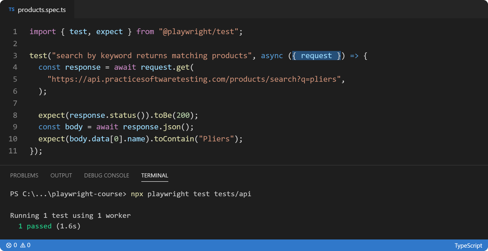

Test pass trong khoảng một giây, và không có cửa sổ browser nào được mở.

## 2. Địa chỉ gốc và header dùng chung

### Khai báo địa chỉ API trong .env

Test đầu tiên ghi địa chỉ API đầy đủ, và khi file có hàng chục lời gọi, địa chỉ này lặp lại ở mọi dòng. `baseURL` trong config không dùng được cho API test, vì đang trỏ tới giao diện `https://practicesoftwaretesting.com`, còn API nằm ở `https://api.practicesoftwaretesting.com`.

Địa chỉ API là thông tin cấu hình môi trường, cùng loại với `BASE_URL`, nên đặt trong `.env` như đã làm ở Buổi 8. Bổ sung dòng `API_URL` vào cả `.env` và `.env.example`:

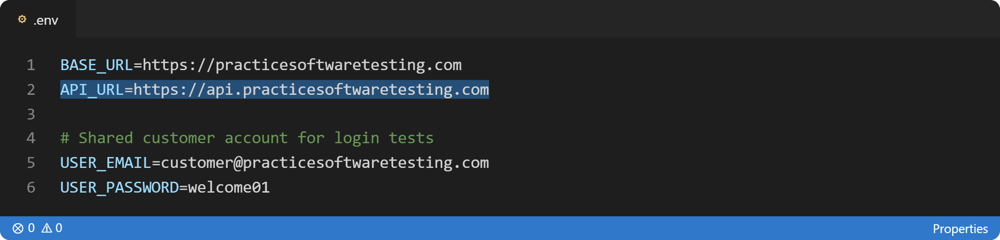

Sau đó đọc biến này trong `utils/env.ts` bằng hàm `getEnv` của Buổi 8:

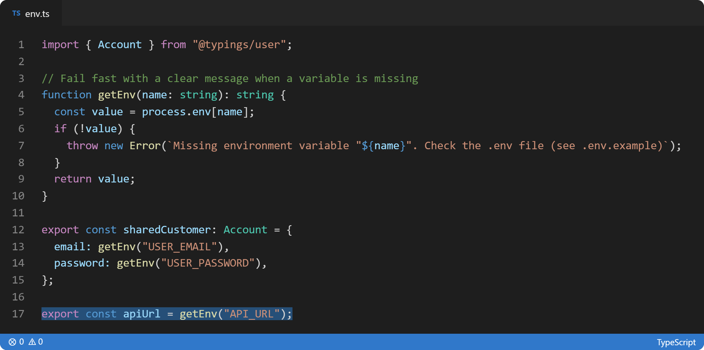

### Ghi đè thiết lập cho một file bằng test.use

`test.use({...})` đặt ở đầu file test ghi đè các thiết lập trong khối `use` của config, chỉ cho các test trong file đó. Với `baseURL` trỏ tới API, lời gọi chỉ cần đường dẫn tương đối, và `params` được Playwright ghép thành query string `?q=pliers`:

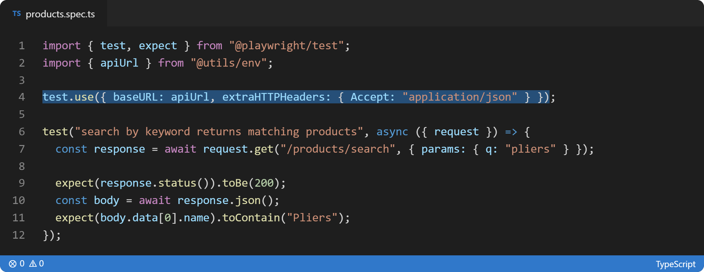

Các file UI test không bị ảnh hưởng và vẫn dùng `baseURL` của config. `extraHTTPHeaders` gửi header `Accept: application/json` kèm mọi request trong file, báo cho server biết client muốn nhận kết quả dạng JSON. Header này là bắt buộc với Toolshop: thiếu header, khi dữ liệu gửi lên không hợp lệ, server không trả lỗi dạng JSON mà chuyển hướng sang một trang khác, và test nhận về status 404. Hiện tượng này được minh họa trong phần kiểm tra lỗi validation của giỏ hàng.

Mọi file trong `tests/api/` bắt đầu bằng cùng dòng `test.use(...)` như trên.

## 3. GET và assertion trên response

### Khai báo kiểu cho body

`response.json()` trả về kiểu `any`: gõ sai tên trường không bị báo lỗi, test chỉ fail lúc chạy với giá trị `undefined`. Khai báo interface (Buổi 3) cho body để VS Code gợi ý tên trường. `GET /products` trả về danh sách có phân trang, mỗi trang 9 sản phẩm nằm trong mảng `data`:

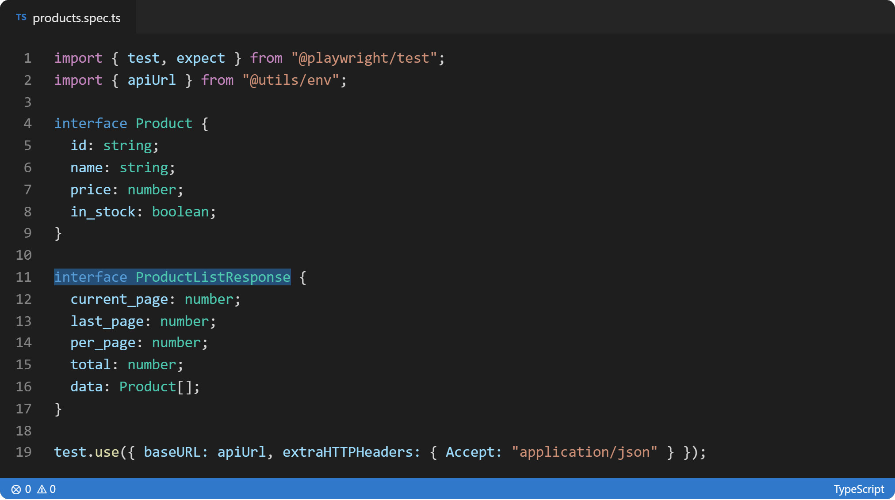

### Kiểm tra status, header và body

Gán body vào biến có kiểu `ProductListResponse`, từ đó `body.data` và `body.current_page` được VS Code kiểm tra. `toBeOK()` pass khi status nằm trong khoảng 200-299 và là matcher bất đồng bộ, bắt buộc có `await`. Tên header trong `response.headers()` luôn viết thường:

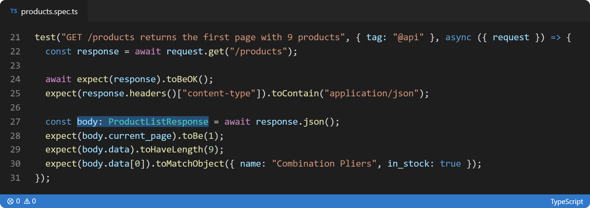

### Kiểm tra quy tắc thay vì dữ liệu cụ thể

Test sắp xếp không ghi cứng danh sách giá mong đợi. `map` (Buổi 3) lấy mảng giá, và bản sao đã sắp xếp tăng dần phải trùng với mảng gốc. `sort()` thay đổi mảng gốc, nên cần sao chép bằng spread (Buổi 9) trước khi sắp xếp:

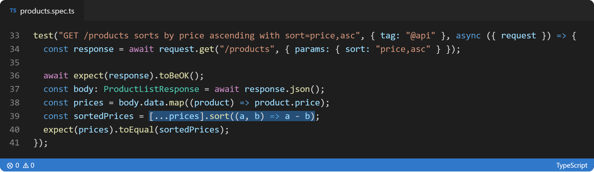

Assertion kiểm tra quy tắc (giá tăng dần), nên test vẫn đúng khi danh sách sản phẩm thay đổi.

### Trường hợp sản phẩm không tồn tại

Mỗi endpoint cần ít nhất một test cho dữ liệu không tồn tại. Toolshop trả status 404 kèm thông báo trong trường `message`:

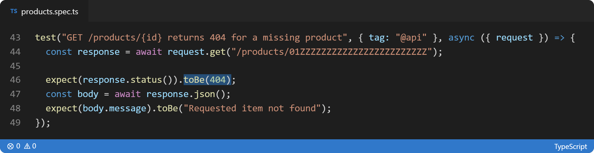

### id của dữ liệu thay đổi mỗi ngày

Dữ liệu của Toolshop được khôi phục về trạng thái ban đầu mỗi ngày, và mỗi lần khôi phục, mọi sản phẩm nhận `id` mới. Test ghi cứng `id` lấy từ DevTools hay Swagger sẽ pass hôm nay và fail ngày mai với 404. Test cần chi tiết một sản phẩm thì lấy `id` từ một request khác trước, ví dụ từ kết quả tìm kiếm theo tên:

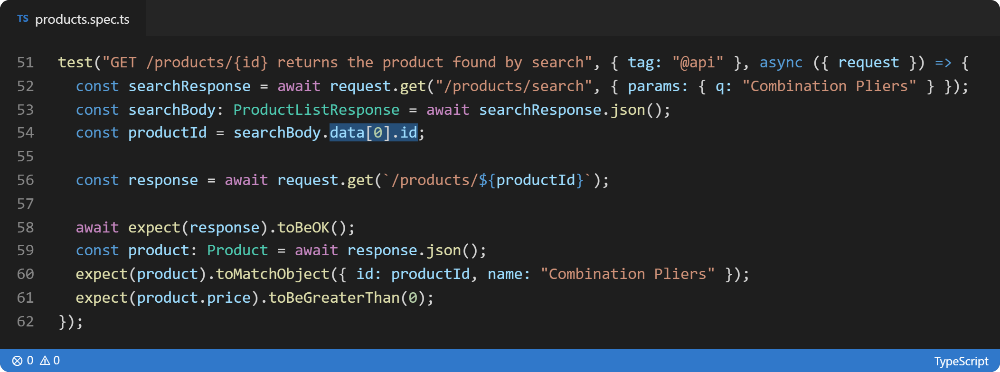

Tên sản phẩm ổn định qua các lần khôi phục, còn `id` thì không. Test 404 ở trên dùng một `id` cố ý không tồn tại, nên không bị ảnh hưởng.

### Các method của response

| Method         | Trả về                                    | Ghi chú                                             |
| -------------- | ----------------------------------------- | --------------------------------------------------- |
| `status()`     | Số, ví dụ `200`, `404`                    | Assertion phổ biến nhất                             |
| `ok()`         | `true` khi status từ 200 đến 299          | Dùng trong `if`; trong assertion ưu tiên `toBeOK()` |
| `statusText()` | Chuỗi, ví dụ `"OK"`, `"Not Found"`        |                                                     |
| `headers()`    | Object các header, tên header viết thường | `headers()["content-type"]`                         |
| `json()`       | Body đã chuyển thành object hoặc mảng     | Báo lỗi nếu body không phải JSON                    |
| `text()`       | Body dạng chuỗi nguyên bản                | Dùng để in ra khi `json()` báo lỗi                  |
| `url()`        | Địa chỉ đầy đủ đã gọi                     | Kiểm tra `baseURL` và `params` được ghép đúng       |

Khi `response.json()` báo lỗi `SyntaxError: Unexpected token <`, server đã trả về HTML (trang lỗi, trang bảo trì) thay vì JSON. In `await response.text()` và `response.url()` ra terminal để xem server thực sự trả về gì.

### Các matcher dùng cho dữ liệu

| Matcher                           | Kiểm tra                                               | Ví dụ                                                  |
| --------------------------------- | ------------------------------------------------------ | ------------------------------------------------------ |
| `toBe(value)`                     | Bằng chính xác (số, chuỗi, boolean)                    | `expect(response.status()).toBe(201)`                  |
| `toEqual(value)`                  | Object hoặc mảng có nội dung giống hệt                 | `expect(cart.cart_items).toEqual([])`                  |
| `toMatchObject(object)`           | Object chứa các trường liệt kê, các trường khác bỏ qua | `expect(product).toMatchObject({ in_stock: true })`    |
| `toHaveLength(n)`                 | Mảng hoặc chuỗi có đúng độ dài                         | `expect(body.data).toHaveLength(9)`                    |
| `toContain(item)`                 | Chuỗi chứa chuỗi con, hoặc mảng chứa phần tử           | `expect(product.name).toContain("Pliers")`             |
| `toHaveProperty(path)`            | Object có trường tên đó                                | `expect(product).toHaveProperty("brand.name")`         |
| `toBeGreaterThan(n)`              | So sánh số                                             | `expect(product.price).toBeGreaterThan(0)`             |
| `await expect(response).toBeOK()` | Status trong khoảng 200-299                            | Dùng cho response, không dùng cho giá trị thông thường |


Assert đúng những trường nghiệp vụ cần kiểm tra bằng `toMatchObject`, thay vì `toEqual` toàn bộ body. Server bổ sung một trường mới (ví dụ `co2_rating`) là thay đổi bình thường và không nên làm test fail.



Quên `await` trước `expect(response).toBeOK()` làm assertion không được chờ: test có thể pass dù status sai. Các matcher với giá trị thông thường (`toBe`, `toEqual`) không cần `await`.


## 4. POST, PUT, DELETE

### API giỏ hàng

Các method ghi dữ liệu được minh họa trên API giỏ hàng của Toolshop. API này không yêu cầu đăng nhập, và mỗi test tự tạo một giỏ hàng mới, nên test không ảnh hưởng tới dữ liệu của người khác.

| Method | Endpoint                              | Body                       | Kết quả                             |
| ------ | ------------------------------------- | -------------------------- | ----------------------------------- |
| POST   | `/carts`                              | Không có                   | 201, body `{ id }` của giỏ hàng mới |
| POST   | `/carts/{cartId}`                     | `{ product_id, quantity }` | 200, thêm sản phẩm vào giỏ          |
| GET    | `/carts/{cartId}`                     | Không có                   | 200, giỏ hàng với mảng `cart_items` |
| PUT    | `/carts/{cartId}/product/quantity`    | `{ product_id, quantity }` | 200, cập nhật số lượng              |
| DELETE | `/carts/{cartId}/product/{productId}` | Không có                   | 204, xóa một sản phẩm khỏi giỏ      |
| DELETE | `/carts/{cartId}`                     | Không có                   | 204, xóa giỏ hàng                   |

### Bước chuẩn bị dùng chung

Mọi test giỏ hàng cần `id` của một sản phẩm và một giỏ hàng mới. Hai bước chuẩn bị này được tách thành hai hàm (Buổi 1) ở đầu `tests/api/carts.spec.ts`. Fixture chỉ có trong tham số của test, nên hàm nhận `request` qua tham số với kiểu `APIRequestContext`:

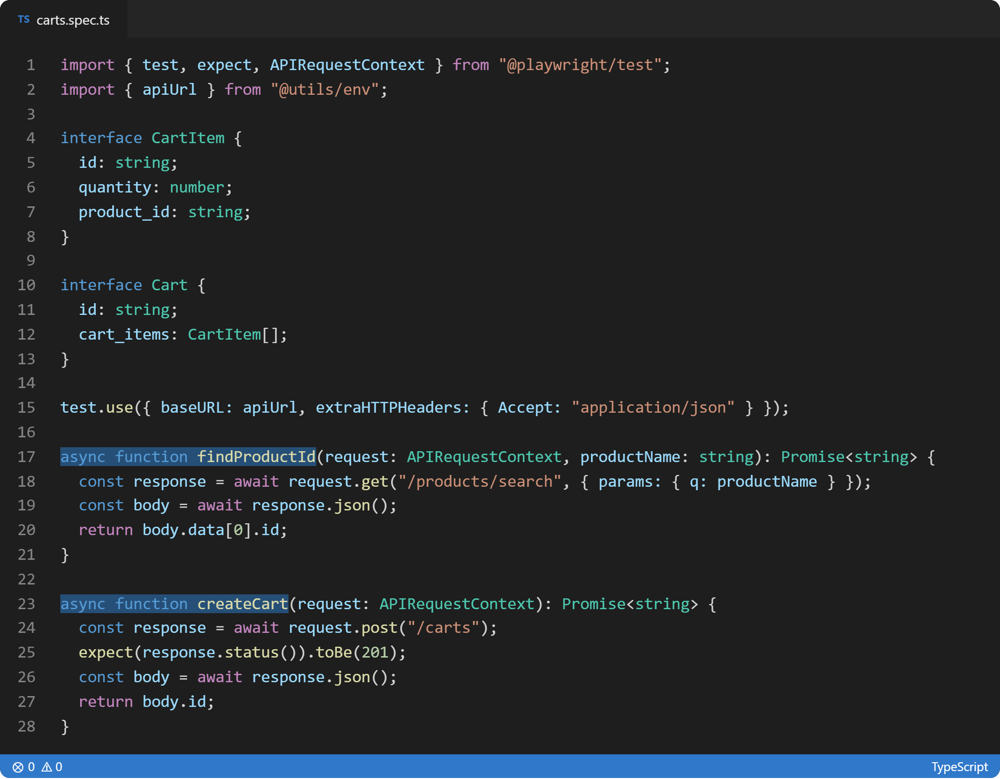

`createCart` assert status 201 ngay ở bước chuẩn bị: nếu API tạo giỏ hàng hỏng, test fail với lý do rõ ràng thay vì fail mơ hồ ở bước sau.

### POST

`request.post()` gửi body qua `data`: Playwright tự chuyển object thành JSON và đặt header `Content-Type: application/json`. Response của thao tác ghi chỉ báo thành công, nên test đọc lại giỏ hàng bằng `GET` để kiểm tra dữ liệu thực sự đã thay đổi:

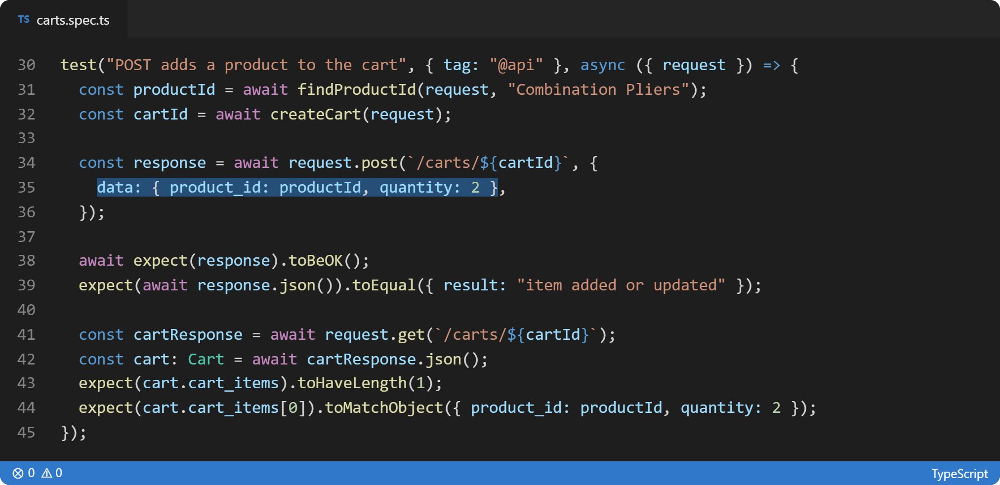

### PUT và DELETE

`put` và `delete` dùng cùng cú pháp với `post`, chỉ khác method. Thao tác thêm sản phẩm ở đầu test là bước chuẩn bị, chỉ thao tác cập nhật được assert:

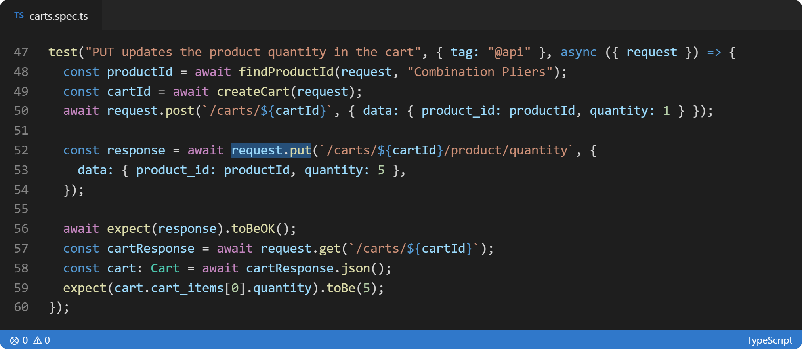

Status 204 (No Content) nghĩa là thành công và body rỗng, nên test DELETE không gọi `response.json()` trên response đó:

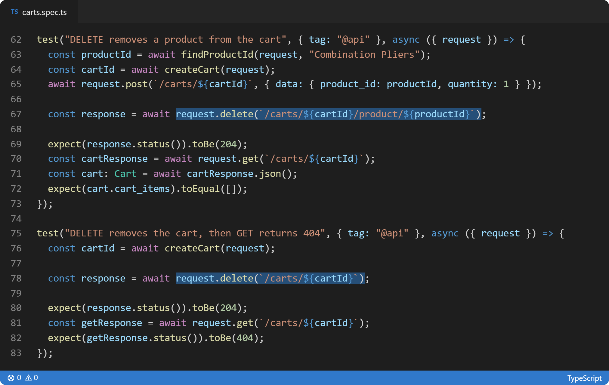

Mỗi test vẫn gọi hai hàm chuẩn bị ở đầu thân test. Buổi 11 trình bày hook `beforeEach` để Playwright tự chạy các bước chuẩn bị này trước mỗi test.

`request` còn có method `patch` với cú pháp giống hệt `put`, dùng cho các API cập nhật một phần dữ liệu. API giỏ hàng của Toolshop không có endpoint `PATCH`.

### Tham số của các lời gọi

Tham số thứ hai của `get`, `post`, `put`, `patch`, `delete` là object tùy chọn:

| Tùy chọn           | Kiểu                    | Ý nghĩa                                                                                                     |
| ------------------ | ----------------------- | ----------------------------------------------------------------------------------------------------------- |
| `data`             | Object, mảng hoặc chuỗi | Body của request. Truyền object thì Playwright tự chuyển sang JSON và đặt `Content-Type: application/json` |
| `params`           | Object                  | Query string, ghép vào sau dấu `?`                                                                          |
| `headers`          | Object                  | Header bổ sung cho riêng lời gọi này, gộp với `extraHTTPHeaders`                                            |
| `form`             | Object                  | Body dạng `application/x-www-form-urlencoded`, dùng cho form kiểu cũ                                        |
| `timeout`          | Số mili giây            | Thời gian chờ tối đa cho lời gọi, mặc định 30 giây                                                          |
| `failOnStatusCode` | Boolean                 | `true`: lời gọi báo lỗi khi status không phải 2xx. Mặc định `false` để test tự assert status               |

### Kiểm tra lỗi validation

Khi body thiếu trường bắt buộc, Toolshop trả status 422 (Unprocessable Content). Body lỗi có dạng `{ message, errors }`, trong đó `errors` chứa danh sách thông báo lỗi theo tên từng trường:

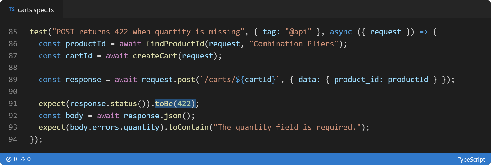


Xóa `extraHTTPHeaders` khỏi dòng `test.use(...)` rồi chạy lại test trên: test fail với `Expected: 422, Received: 404`, body là `{"message":"Resource not found"}`. Thiếu header `Accept: application/json`, server xử lý request như một form trên trình duyệt: dữ liệu không hợp lệ thì chuyển hướng về trang trước, và địa chỉ chuyển hướng không tồn tại trên server API. Status 404 trong trường hợp này không phản ánh lỗi thật. Khi status trả về không khớp với tài liệu Swagger, kiểm tra header trước tiên.



Không tự gọi `JSON.stringify` rồi truyền chuỗi vào `data`. Khi nhận chuỗi, Playwright gửi nguyên chuỗi mà không đặt `Content-Type: application/json`, server không đọc được body và trả 422 với thông báo thiếu `product_id`, dù chuỗi có chứa trường này. Truyền object và để Playwright xử lý.


## 5. Xác thực bằng Bearer token

### Quy trình xác thực

Các API chứa dữ liệu riêng của tài khoản (thông tin cá nhân, sản phẩm yêu thích, hóa đơn) yêu cầu xác thực. Quy trình gồm ba bước:

1. Gửi email và password tới endpoint login, nhận về **access token**: một chuỗi đại diện cho phiên đăng nhập.
2. Gửi token trong header `Authorization` của các request sau, theo định dạng `Bearer <token>`.
3. Server kiểm tra token: hợp lệ thì trả dữ liệu, thiếu hoặc sai thì trả 401 (Unauthorized).

| Method | Endpoint       | Cần token | Kết quả                                                                    |
| ------ | -------------- | --------- | -------------------------------------------------------------------------- |
| POST   | `/users/login` | Không     | Body `{ email, password }`, trả `{ access_token, token_type, expires_in }` |
| GET    | `/users/me`    | Có        | Thông tin tài khoản đang đăng nhập                                         |
| GET    | `/favorites`   | Có        | Mảng sản phẩm yêu thích của tài khoản                                      |
| GET    | `/invoices`    | Có        | Danh sách hóa đơn có phân trang                                            |

`expires_in` bằng `300`: token hết hạn sau 300 giây (5 phút). Không ghi token vào code hay `.env`; mỗi test lấy token mới bằng cách gọi login.

### Login

`sharedCustomer` (Buổi 8) có đúng hai trường `email` và `password` mà endpoint login yêu cầu, nên truyền thẳng vào `data`. Token thay đổi mỗi lần login, nên test chỉ kiểm tra kiểu dữ liệu, không so sánh giá trị:

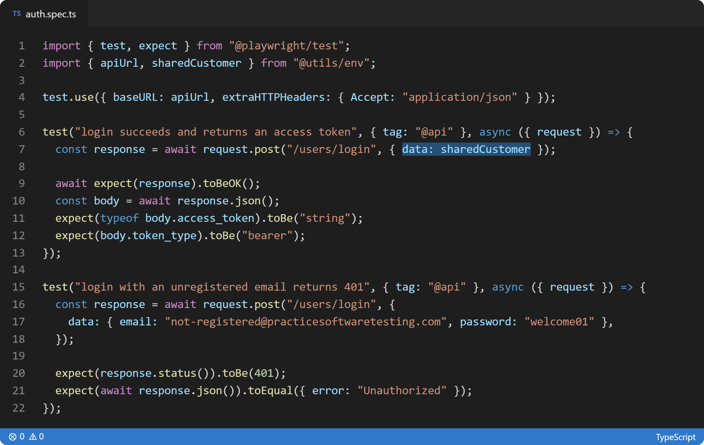


Tài khoản `customer@practicesoftwaretesting.com` bị khóa sau 3 lần nhập sai password, và cả lớp dùng chung tài khoản này. Test login thất bại luôn dùng email chưa đăng ký, không dùng password sai cho tài khoản chung.


### Gửi token trong header

Token lấy từ body của response login bằng destructuring (Buổi 1), sau đó gửi trong header `Authorization` theo định dạng `Bearer <token>`: chữ `Bearer`, một dấu cách, rồi token. Header riêng của lời gọi được gộp với header `Accept` khai báo trong `test.use`:

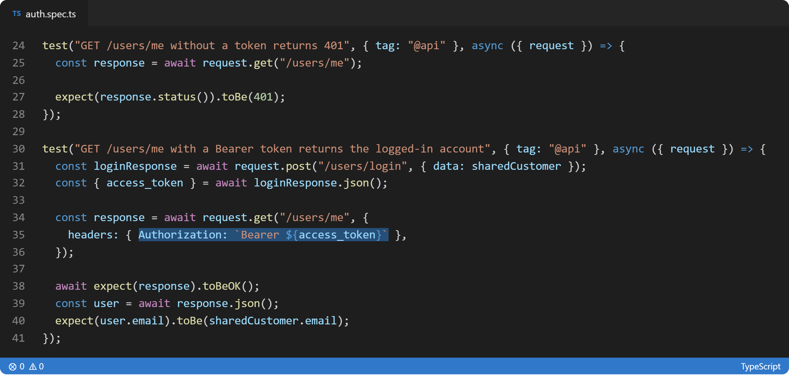

### Context có sẵn token với newContext

Khi nhiều lời gọi trong một test cùng cần token, lặp lại `headers` ở từng dòng làm test dài và dễ thiếu sót. Fixture có sẵn `playwright` tạo một `APIRequestContext` riêng bằng `playwright.request.newContext()`, với `baseURL` và header áp dụng cho mọi lời gọi qua context đó:

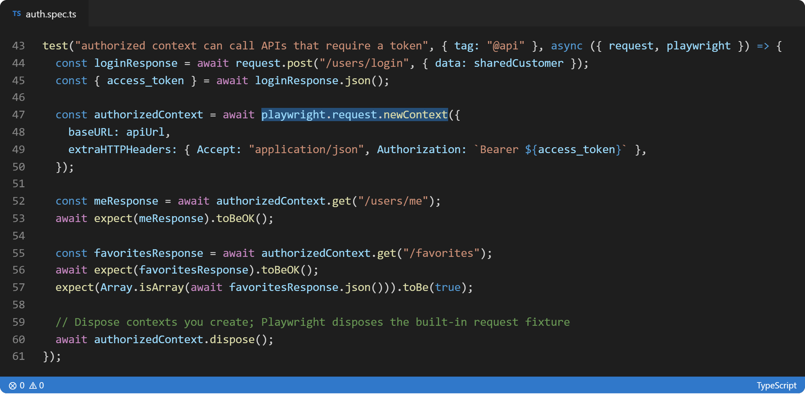

Context tự tạo thì phải tự đóng bằng `dispose()`; fixture `request` có sẵn được Playwright đóng sau test. Test chỉ kiểm tra body của `/favorites` là mảng, không assert số lượng, vì dữ liệu của tài khoản chung có thể bị người khác thay đổi (Buổi 9).

## 6. Tổ chức bộ test API

| Quy ước       | Nội dung                                                                                                      |
| ------------- | ------------------------------------------------------------------------------------------------------------- |
| Vị trí        | `tests/api/`, mỗi nhóm endpoint một file: `products.spec.ts`, `carts.spec.ts`, `auth.spec.ts`                 |
| Đầu file      | `test.use` với `baseURL: apiUrl` và header `Accept: application/json`                                         |
| Tên test      | Method và endpoint, kèm kết quả mong đợi và status khi có: `"GET /products/{id} returns 404 for a missing product"` |
| Tag           | Mọi test API có `@api` theo quy ước tag của khóa học (Buổi 9), thêm `@smoke` cho endpoint cốt lõi              |
| Mỗi test      | Ít nhất một assertion về status và một assertion về body                                                      |
| Trường hợp âm | Mỗi endpoint có ít nhất một test cho dữ liệu sai, dữ liệu không tồn tại hoặc thiếu token                      |
| Dữ liệu       | Không ghi cứng `id`. Không assert số lượng chính xác của dữ liệu thuộc tài khoản chung                         |
| Độc lập       | Mỗi test tự tạo dữ liệu cần dùng, không dựa vào dữ liệu do test khác tạo                                      |

Buổi 11 trình bày cách nhóm các test theo endpoint bằng `test.describe` và gắn tag cho cả nhóm.

API test có tag `@api` chạy được cùng UI test có tag `@smoke` trong một lệnh trước khi tạo Pull Request:

```bash
npx playwright test --grep "@smoke|@api"
```

## 7. Thực hành tại lớp: API danh mục sản phẩm

Viết API test cho chức năng lọc sản phẩm theo danh mục.

### Các bước thực hiện

1. Mở tài liệu Swagger, tìm `GET /categories/tree` và tham số `by_category` của `GET /products`.
2. Trên trang chủ Toolshop, chọn một danh mục trong bộ lọc và quan sát request trong tab Network của DevTools.
3. Gọi thử `GET /categories/tree`, đọc cấu trúc body: danh mục cha, danh mục con và các trường của mỗi danh mục.
4. Tạo `tests/api/categories.spec.ts`, khai báo interface cho body và viết test.
5. Chạy `npx playwright test tests/api/categories.spec.ts`.

### Câu hỏi thiết kế

Trả lời các câu hỏi sau trước khi viết code:

* `id` của danh mục thay đổi mỗi ngày. Test lọc theo danh mục "Pliers" lấy `id` của danh mục này từ đâu?
* Với kết quả lọc, assertion nào chứng minh bộ lọc hoạt động đúng mà không phụ thuộc vào số lượng sản phẩm hiện có?
* Lọc theo một `id` danh mục không tồn tại thì API trả về gì? Kết quả đó có hợp lý từ góc độ nghiệp vụ không, và test nên ghi nhận điều này như thế nào?

## 8. Tóm tắt

| Nội dung                | Điểm chính                                                                                                     |
| ----------------------- | -------------------------------------------------------------------------------------------------------------- |
| Fixture `request`       | Gửi request HTTP trong test, không mở browser. Mỗi lời gọi được ghi vào report                                 |
| `test.use`              | Ghi đè thiết lập cho một file: `baseURL` trỏ tới API, header `Accept: application/json` cho mọi request       |
| Assertion trên response | `toBeOK()` có `await`; assert status và các trường nghiệp vụ bằng `toMatchObject`; khai báo interface cho body |
| Dữ liệu Toolshop        | `id` thay đổi mỗi ngày: lấy `id` qua request khác, không ghi cứng                                              |
| POST, PUT, DELETE       | Body truyền dạng object qua `data`. Sau thao tác ghi, kiểm tra lại dữ liệu bằng request đọc                    |
| Lỗi validation          | Status 422 kèm `errors` theo từng trường. Status không khớp tài liệu thì kiểm tra header trước                 |
| Bearer token            | Login lấy token, gửi trong header `Authorization: Bearer <token>`. Token hết hạn sau 5 phút, lấy mới trong mỗi test |
| `newContext`            | Context riêng có sẵn `baseURL` và header, tự đóng bằng `dispose()`                                             |

## 9. Bài tập về nhà

Không nhập password sai cho tài khoản chung.

### Bài 1: cấu hình API test

* Project có biến `API_URL` trong `.env` và `.env.example`, đọc qua `utils/env.ts`.
* Mọi API test nằm trong `tests/api/`, dùng đường dẫn tương đối và gửi header `Accept: application/json`.
* Chạy `npx playwright test tests/api` không mở browser và toàn bộ test pass.

### Bài 2: API thương hiệu và sản phẩm

Viết API test kiểm tra:

* `GET /brands` trả về danh sách thương hiệu, mỗi thương hiệu có `id`, `name` và `slug`.
* Lọc `GET /products` theo một thương hiệu chỉ trả về sản phẩm của thương hiệu đó.
* Tìm kiếm bằng một từ khóa không khớp với sản phẩm nào. Xác định kết quả API trả về và viết assertion cho kết quả đó.
* `GET /brands/{id}` với `id` không tồn tại trả về 404.

### Bài 3: các trường hợp âm của giỏ hàng

Bổ sung vào `tests/api/carts.spec.ts` các test:

* Thêm sản phẩm với `product_id` không tồn tại trả về 422, có thông báo lỗi cho trường `product_id`.
* Thêm sản phẩm vào giỏ hàng không tồn tại.
* Thêm cùng một sản phẩm hai lần vào một giỏ.

Với hai trường hợp sau, gọi thử API để xác định hành vi thực tế trước khi viết assertion, và ghi trong mô tả Pull Request: hành vi đó có hợp lý từ góc độ nghiệp vụ không.

### Bài 4: API cần xác thực

* `GET /invoices` kèm token của tài khoản chung trả về danh sách hóa đơn có phân trang. Không assert số lượng hóa đơn.
* `GET /invoices` và `GET /favorites` không có token trả về 401.
* `GET /users/me` với token không hợp lệ trả về 401.
