# Buổi 11 · Hooks, Fixtures & Tổ chức Test Suite

Khi số lượng test tăng, code test bắt đầu lặp lại: cùng một bước chuẩn bị ở đầu nhiều test, cùng một logic kiểm tra cho nhiều bộ dữ liệu. Buổi này trình bày cách tổ chức code test để loại bỏ phần lặp lại.

## 1. Nhóm test với test.describe

### Cú pháp

`test.describe` nhận một tên nhóm và một hàm chứa các test thuộc nhóm đó. Tên nhóm được ghép vào trước tên test ở mọi nơi Playwright hiển thị test: terminal, HTML report, Trace Viewer. Kiểm tra bằng `--list` (Buổi 9):


<!-- TODO(image): HTML report sau khi chạy npx playwright test với các file test đã nhóm bằng test.describe: mỗi dòng hiển thị đường dẫn nhóm trước tên test, ví dụ "Đăng nhập › đăng nhập thành công với tài khoản hợp lệ" và "Giỏ hàng › Xóa sản phẩm › ...". Khoanh đỏ phần tên nhóm ở hai dòng, một dòng có một cấp describe và một dòng có hai cấp. -->

### Nhóm lồng nhau

Một `describe` có thể đặt bên trong một `describe` khác để tạo nhóm con:

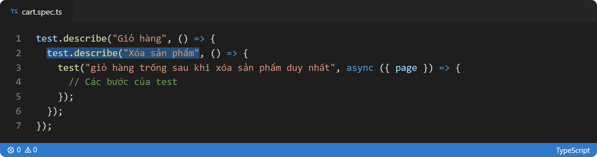

Tên đầy đủ của test là `Giỏ hàng › Xóa sản phẩm › giỏ hàng trống sau khi xóa sản phẩm duy nhất`.

### Tag và only, skip cho cả nhóm

Tag (Buổi 9) khai báo ở `describe` áp dụng cho mọi test bên trong nhóm. Test vẫn có thể có thêm tag riêng:

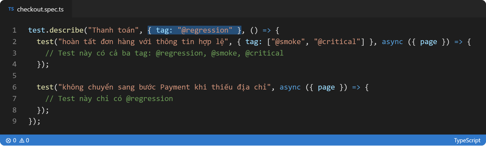

Tương tự, `test.describe.only(...)`, `test.describe.skip(...)` và `test.describe.fixme(...)` áp dụng quy tắc của `only`, `skip`, `fixme` (Buổi 9) cho cả nhóm.

### Quy ước đặt tên

| Thành phần       | Quy ước                                                              | Ví dụ                                               |
| ---------------- | -------------------------------------------------------------------- | --------------------------------------------------- |
| Tên file         | Một tính năng một file, `<feature>.spec.ts`, tiếng Anh kebab-case    | `checkout.spec.ts`                                  |
| Tên `describe`   | Danh từ chỉ tính năng hoặc thao tác, tiếng Việt                      | `"Thanh toán"`, `"Xóa sản phẩm"`                    |
| Tên `test`       | Câu mô tả kết quả mong đợi, đọc được mà không cần mở code            | `"giỏ hàng trống sau khi xóa sản phẩm duy nhất"`    |


`test.describe.configure({ mode: "serial" })` buộc các test trong nhóm chạy tuần tự và dừng cả nhóm khi một test fail. Cấu hình này không phải cách để test A chuẩn bị dữ liệu cho test B: nguyên tắc "mỗi test tự chuẩn bị trạng thái" (Buổi 9) vẫn áp dụng. Khóa học không sử dụng `serial`.


## 2. Hooks

Mọi test trong `cart.spec.ts` và `checkout.spec.ts` bắt đầu bằng cùng một đoạn code đăng nhập:

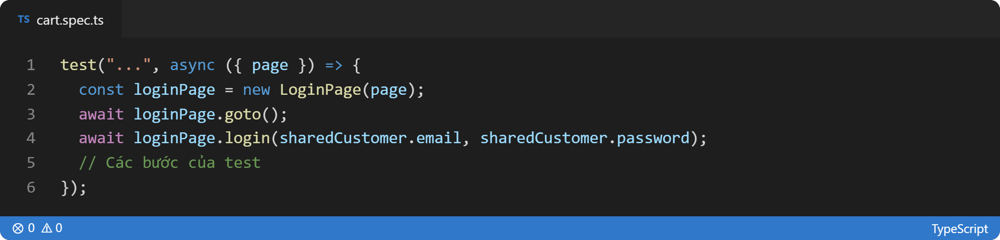

**Hook** là hàm Playwright tự động gọi tại các thời điểm xác định trong quá trình chạy test. Hook `beforeEach` tập trung đoạn đăng nhập này về một vị trí trong file `tests/cart.spec.ts`:

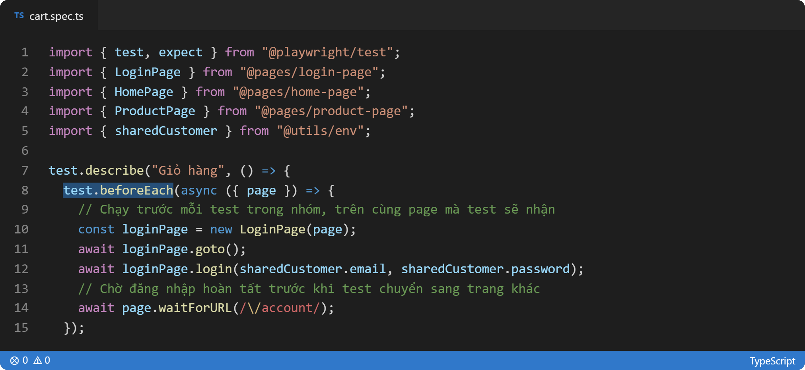

Hai test trong nhóm không còn đoạn đăng nhập ở đầu thân test:

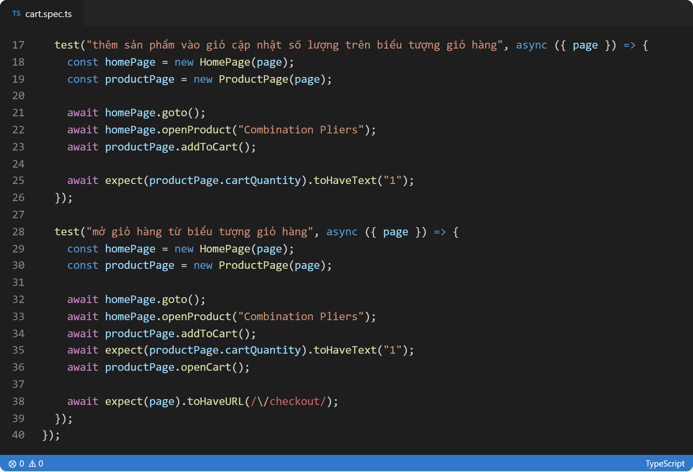

`page` trong `beforeEach` và `page` trong test là cùng một object: hook đăng nhập xong, test nhận trang đã đăng nhập.

Dòng `page.waitForURL()` (Buổi 6) là bước chờ cần thiết. `login()` kết thúc ngay sau khi bấm nút Login, trong khi Toolshop cần thêm thời gian để xử lý đăng nhập. Nếu test gọi `homePage.goto()` ngay sau đó, trang có thể chuyển đi trước khi đăng nhập hoàn tất, và test fail không ổn định.

### Hook trong API test

Các test giỏ hàng của Buổi 10 cũng bắt đầu bằng cùng hai bước chuẩn bị: gọi `findProductId()` và `createCart()`. Với `beforeEach`, hai bước này chạy tự động trước mỗi test, và giá trị chuẩn bị được lưu vào biến khai báo trong `describe`. Cập nhật `tests/api/carts.spec.ts`:


Biến `productId` và `cartId` khai báo bằng `let` trong `describe` để hook và các test trong nhóm cùng sử dụng; hook gán giá trị mới trước mỗi test. Hook nhận fixture giống test: `request` của hook và của test là cùng một object. Tag `@api` khai báo ở `describe` áp dụng cho mọi test trong nhóm.

Mỗi test vẫn nhận một giỏ hàng mới, vì `beforeEach` chạy lại trước từng test.

### Phạm vi của hook

Hook có hiệu lực trong phạm vi nơi nó được khai báo:

| Vị trí khai báo            | Phạm vi áp dụng                                    |
| -------------------------- | -------------------------------------------------- |
| Ngoài mọi `describe`       | Mọi test trong file                                |
| Bên trong một `describe`   | Chỉ các test của nhóm đó, kể cả nhóm con bên trong |

Ví dụ, chỉ các test xóa sản phẩm cần có sẵn sản phẩm trong giỏ. Bước chuẩn bị này đặt trong `beforeEach` của nhóm "Xóa sản phẩm", không ảnh hưởng tới các test khác của nhóm "Giỏ hàng":


Với test "giỏ hàng trống sau khi xóa sản phẩm duy nhất", `beforeEach` của nhóm ngoài chạy trước, sau đó đến `beforeEach` của nhóm trong, cuối cùng là test.

### Các loại hook

| Hook              | Thời điểm chạy                                                  | Fixture sử dụng được                    |
| ----------------- | --------------------------------------------------------------- | --------------------------------------- |
| `test.beforeEach` | Trước mỗi test trong phạm vi                                    | `page` và mọi fixture cấp test          |
| `test.afterEach`  | Sau mỗi test trong phạm vi, kể cả khi test fail                 | `page` và mọi fixture cấp test          |
| `test.beforeAll`  | Một lần trước các test trong phạm vi, lặp lại trên mỗi worker   | `browser`, không có `page` và `context` |
| `test.afterAll`   | Một lần sau các test trong phạm vi, lặp lại trên mỗi worker     | `browser`, không có `page` và `context` |

Thứ tự chạy với một nhóm gồm hai test, trên cùng một worker:

```
beforeAll
  beforeEach → test 1 → afterEach
  beforeEach → test 2 → afterEach
afterAll
```

Hook `afterEach` nhận tham số thứ hai `testInfo`, chứa thông tin về test vừa chạy. Ví dụ ghi lại URL cuối cùng của các test không pass:

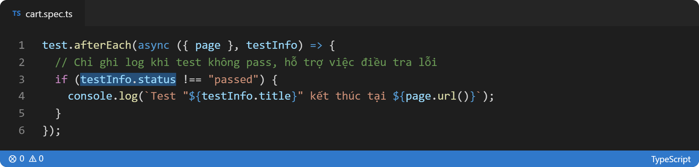


**Không dùng `beforeAll` để đăng nhập một lần rồi dùng chung cho mọi test.** `beforeAll` không có `page`, và Playwright báo lỗi `"context" and "page" fixtures are not supported in "beforeAll"` nếu khai báo `page`. Với nhiều worker, `beforeAll` chạy một lần trên mỗi worker, không phải một lần cho cả bộ test. Tự tạo `page` trong `beforeAll` để dùng chung giữa các test làm các test phụ thuộc nhau (Buổi 9). `beforeAll` chỉ phù hợp với việc chuẩn bị không thao tác trên trang web.


### Hạn chế của hook

`beforeEach` chỉ có hiệu lực trong file khai báo nó. `cart.spec.ts` và `checkout.spec.ts` đều cần đăng nhập, vì vậy đoạn `beforeEach` phải được sao chép sang cả hai file. Ngoài ra, mọi test trong phạm vi đều chạy `beforeEach`, kể cả test không cần đăng nhập, và các dòng `new ...Page(page)` vẫn lặp lại trong từng test. Custom fixture giải quyết các hạn chế này.

## 3. Custom fixture

### Khái niệm fixture

Từ Buổi 4, mỗi test nhận `page` qua cú pháp destructuring `async ({ page })` (Buổi 1). Buổi 10 sử dụng thêm `request` và `playwright` theo cùng cú pháp. `page` là một **fixture**: đối tượng Playwright chuẩn bị trước khi test chạy và dọn dẹp sau khi test kết thúc.

| Giai đoạn | Việc Playwright thực hiện với fixture `page` |
| --------- | -------------------------------------------- |
| Setup     | Tạo browser context mới, mở một tab mới      |
| Sử dụng   | Truyền `page` vào test                       |
| Teardown  | Đóng browser context sau khi test kết thúc   |

Playwright cho phép định nghĩa fixture riêng cho project bằng `test.extend`. Fixture được định nghĩa một lần trong một file và sử dụng được ở mọi file test.

### Bước 1: tạo fixture đầu tiên

Tạo folder `fixtures/` ngang hàng với `tests/` và `pages/`, sau đó tạo file `fixtures/test-fixtures.ts`:

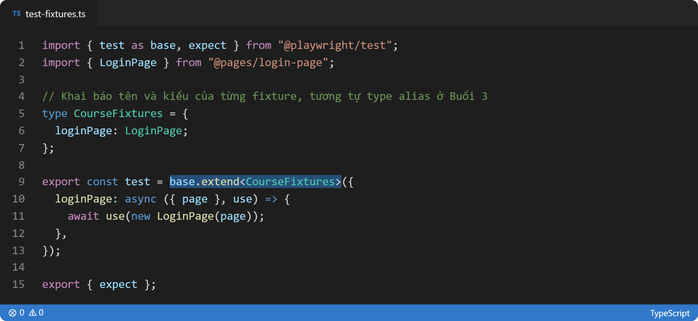

| Thành phần                           | Ý nghĩa                                                                                                     |
| ------------------------------------ | ----------------------------------------------------------------------------------------------------------- |
| `import { test as base }`            | Đổi tên `test` gốc thành `base`, dành tên `test` cho phiên bản mở rộng                                      |
| `type CourseFixtures`                | Khai báo tên và kiểu của fixture, nhờ đó VS Code gợi ý `loginPage` khi viết test                            |
| `base.extend<CourseFixtures>({...})` | Tạo `test` mới, gồm mọi fixture có sẵn của Playwright và các fixture khai báo trong object                  |
| `async ({ page }, use) => {...}`     | Hàm định nghĩa fixture. Tham số thứ nhất chứa các fixture mà fixture này cần, tham số thứ hai là hàm `use` |
| `await use(...)`                     | Giá trị truyền vào `use` là giá trị test nhận được. Code trước `use` là setup, code sau `use` là teardown  |
| `export { expect }`                  | Xuất lại `expect` để file test import `test` và `expect` từ cùng một file                                  |

### Bước 2: sử dụng fixture trong test

File test import `test` và `expect` từ file fixture thay vì từ `@playwright/test`, sau đó khai báo fixture cần dùng trong tham số của test:

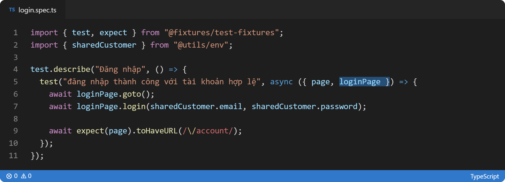

So với cách viết trước, test không còn dòng `const loginPage = new LoginPage(page);` và không cần import `LoginPage`. Playwright chỉ chạy fixture mà test khai báo: test không khai báo `loginPage` thì fixture `loginPage` không được tạo.


Sau khi có file fixture, mọi file test phải import `test` từ `@fixtures/test-fixtures`, kể cả các file API test trong `tests/api/`. File còn import từ `@playwright/test` mà khai báo fixture mới sẽ bị VS Code báo lỗi `Property 'loginPage' does not exist on type ...`, và khi chạy, Playwright báo lỗi `Test has unknown parameter "loginPage"`.


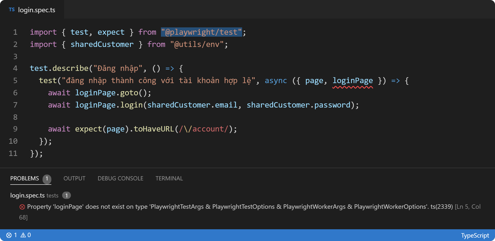

### Bước 3: fixture có setup và sử dụng fixture khác

Bổ sung fixture `authenticatedPage`: một `page` đã đăng nhập bằng tài khoản chung. Cập nhật `fixtures/test-fixtures.ts`:

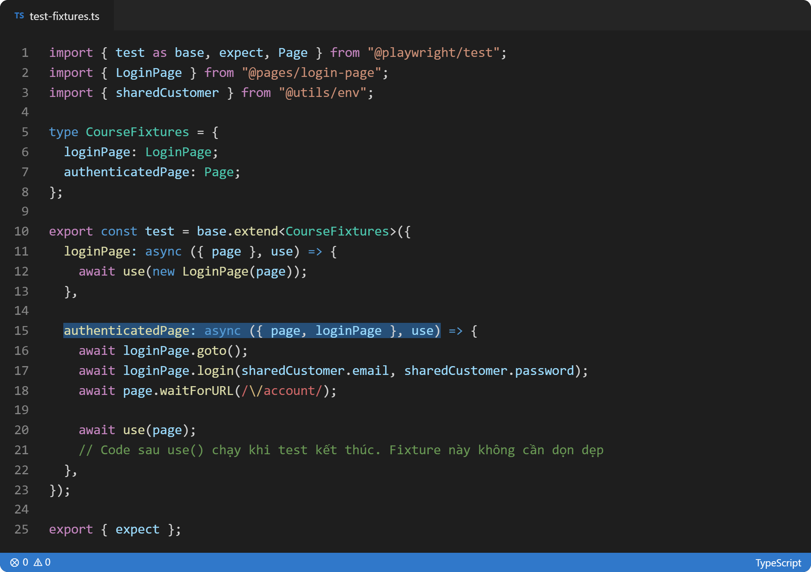

`authenticatedPage` khai báo cần hai fixture khác: `page` của Playwright và `loginPage` vừa tạo ở bước 1. Khi một test khai báo `authenticatedPage`, Playwright tự tạo các fixture theo thứ tự phụ thuộc, chạy test, sau đó dọn dẹp theo thứ tự ngược lại:


`authenticatedPage` và `page` là cùng một object, khác nhau ở trạng thái: khi test bắt đầu, `authenticatedPage` đã đăng nhập.

### Bước 4: fixture cho page object

Tương tự `loginPage`, khai báo fixture cho các page object còn lại. Nội dung hoàn chỉnh của `fixtures/test-fixtures.ts`:


Viết lại `tests/cart.spec.ts` bằng fixture:

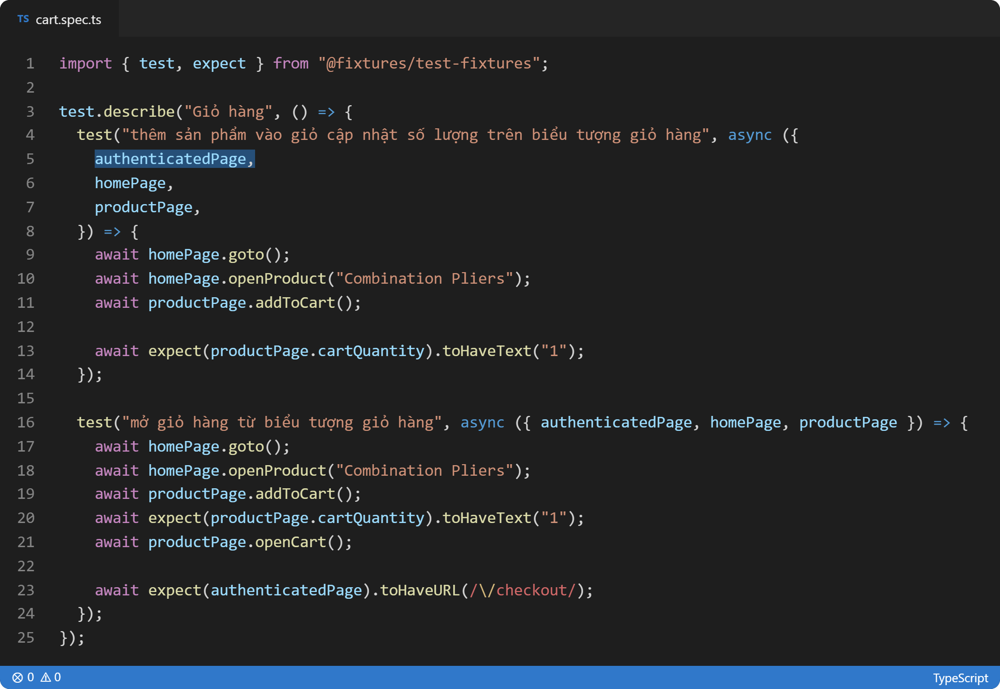

Test thứ nhất khai báo `authenticatedPage` nhưng không sử dụng biến này trong thân test. Việc khai báo tương đương mục **điều kiện tiên quyết** "Đã đăng nhập" của một test case thủ công: Playwright đăng nhập trước khi test chạy. Test không khai báo `authenticatedPage` bắt đầu ở trạng thái chưa đăng nhập.

### So sánh trước và sau khi dùng fixture

| Tiêu chí                                      | Trước khi dùng fixture                            | Sau khi dùng fixture                                   |
| --------------------------------------------- | ------------------------------------------------- | ------------------------------------------------------ |
| Bước đăng nhập                                | Ba dòng code ở đầu mọi test cần đăng nhập         | Khai báo `authenticatedPage` trong tham số của test    |
| Tạo page object                               | `new HomePage(page)` trong từng test              | Khai báo `homePage` trong tham số của test             |
| Thay đổi cách đăng nhập (ví dụ thêm bước chờ) | Sửa mọi test, trong mọi file                      | Sửa một fixture                                        |
| Test không cần đăng nhập                      | Vẫn chạy `beforeEach` nếu nằm trong phạm vi hook  | Không khai báo `authenticatedPage`, không bị đăng nhập |

### Hook hay fixture

| Tiêu chí           | Hook (`beforeEach`)                                          | Fixture (`test.extend`)                                                  |
| ------------------ | ------------------------------------------------------------ | ------------------------------------------------------------------------ |
| Phạm vi            | Một file hoặc một nhóm `describe`                            | Mọi file import file fixture                                             |
| Test bị ảnh hưởng  | Mọi test trong phạm vi, kể cả test không cần                 | Chỉ test khai báo fixture                                                |
| Kết hợp            | Không dùng lại được ở file khác                              | Fixture sử dụng được fixture khác                                        |
| Trường hợp sử dụng | Bước chuẩn bị chỉ dành cho các test của một file hoặc một nhóm | Trạng thái dùng chung toàn project: đăng nhập, page object, dữ liệu test |

Quy ước của khóa học từ buổi này: trạng thái dùng chung được khai báo bằng fixture, hook chỉ dùng cho bước chuẩn bị riêng của một file hoặc một nhóm. Ví dụ bước "thêm một sản phẩm vào giỏ" của nhóm "Xóa sản phẩm" vẫn phù hợp với `beforeEach`. Buổi 13 đặt `fixtures/` vào cấu trúc folder chuẩn của framework.


Với fixture `authenticatedPage`, mỗi test đăng nhập lại qua giao diện. Với bộ test lớn, Playwright hỗ trợ lưu trạng thái đăng nhập một lần và sử dụng lại cho nhiều test. Nội dung này nằm ngoài phạm vi khóa học, tham khảo tại [Authentication](https://playwright.dev/docs/auth).


## 4. Thực hành tại lớp: fixture cho checkout

Áp dụng fixture cho file `tests/checkout.spec.ts` của Buổi 8.

### Các bước thực hiện

1. Đọc lại các test trong `tests/checkout.spec.ts`. Với mỗi bước trong test, xác định bước đó thuộc **điều kiện tiên quyết** hay thuộc **nội dung đang được kiểm tra**.
2. Bổ sung fixture `cartPage` và `checkoutPage` vào `fixtures/test-fixtures.ts`.
3. Chuyển `tests/checkout.spec.ts` sang import `test`, `expect` từ file fixture, nhóm test bằng `describe` và sử dụng các fixture đã có, theo quy trình refactor 3 bước (Buổi 8).
4. Chạy `npx playwright test tests/checkout.spec.ts`.

### Câu hỏi thiết kế

Trả lời các câu hỏi sau trước khi viết code:

* Fixture `cartPage` có nên tự thêm sản phẩm vào giỏ trước khi chuyển cho test không? Xét trường hợp một test cần kiểm tra giỏ hàng trống.
* Fixture `homePage` nên được tạo từ `page` hay từ `authenticatedPage`? Nêu hệ quả của mỗi lựa chọn đối với test không cần đăng nhập.
* Bước Sign in của trang checkout nên nằm trong fixture, trong `beforeEach` hay trong test? Căn cứ vào câu trả lời ở bước 1.

## 5. Parameterized test

### Một test chứa nhiều bộ dữ liệu

Cần kiểm tra trang chi tiết hiển thị đúng tên sản phẩm với ba sản phẩm khác nhau. Cách viết đã dùng ở bài tập Buổi 6, Bài 1 là duyệt mảng dữ liệu bên trong một test:


Cách viết này có ba hạn chế:

| Hạn chế                            | Hệ quả                                                                       |
| ---------------------------------- | ---------------------------------------------------------------------------- |
| Assertion fail dừng cả test        | Sản phẩm thứ hai fail thì sản phẩm thứ ba không được kiểm tra                |
| Report chỉ có một dòng             | Phải đọc thông báo lỗi mới biết bộ dữ liệu nào fail                          |
| Không chạy riêng được một bộ dữ liệu | Muốn kiểm tra lại một sản phẩm phải chạy cả ba                              |

### Vòng lặp sinh ra nhiều test

Đặt vòng lặp bên ngoài `test`, mỗi vòng khai báo một test riêng. Vòng `for` chạy khi Playwright đọc file, trước khi bất kỳ test nào chạy. Tên test là template string (Buổi 1) chứa dữ liệu của chính nó, nên `--list` và report cho biết ngay bộ dữ liệu nào đang chạy:

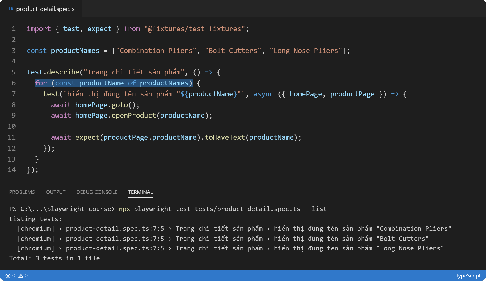

Ba test có cùng vị trí khai báo (dòng 7) nhưng là ba test độc lập: chạy song song trên các worker khác nhau, mỗi test có browser context riêng và một dòng riêng trong report. Một test cụ thể chạy riêng được bằng `--grep "Bolt Cutters"` (Buổi 9).

### Tên test phải duy nhất

Playwright yêu cầu tên đầy đủ của mỗi test là duy nhất. Nếu tên test trong vòng lặp không chứa dữ liệu, ví dụ `test("hiển thị đúng tên sản phẩm", ...)`, ba vòng lặp sinh ra ba test cùng tên và Playwright báo lỗi `duplicate test title` ngay khi đọc file, trước khi chạy bất kỳ test nào.

Khi mỗi bộ dữ liệu là một object gồm nhiều trường, như kiểu dữ liệu đăng nhập ở bài tập Buổi 6, Bài 1, khai báo kiểu cho object bằng `type` hoặc `interface` (Buổi 3) và ghép trường mô tả tình huống vào tên test.

### Trường hợp nên và không nên parameterize

| Nên                                                                   | Không nên                                                                       |
| --------------------------------------------------------------------- | ------------------------------------------------------------------------------- |
| Các bước giống hệt nhau, chỉ khác dữ liệu đầu vào và kết quả mong đợi | Các tình huống có luồng thao tác khác nhau, phải thêm `if` trong thân test       |
| Kiểm tra validation của form: thiếu trường, sai định dạng, sai độ dài | Chỉ có một hoặc hai tình huống, viết hai test thông thường dễ đọc hơn            |
| Cùng một luồng với nhiều sản phẩm hoặc nhiều loại tài khoản           | Bộ dữ liệu quá lớn làm bộ test chạy lâu mà không thêm giá trị kiểm thử          |

Mảng dữ liệu hiện đặt ngay trong file test. Khi dữ liệu dùng chung cho nhiều file hoặc cần sinh ngẫu nhiên, Buổi 13 trình bày cách chuyển sang file JSON trong folder `data/` và thư viện Faker.

## 6. Tóm tắt

| Nội dung           | Điểm chính                                                                                         |
| ------------------ | -------------------------------------------------------------------------------------------------- |
| `test.describe`    | Nhóm test theo tính năng, tên nhóm ghép vào tên test. Tag và `only`, `skip` áp dụng được cho cả nhóm |
| Hook               | Chuẩn bị và dọn dẹp cho các test trong một file hoặc một nhóm. `beforeAll` không có `page`         |
| Fixture            | Chuẩn bị trạng thái dùng chung cho toàn project. Test chỉ nhận fixture mà test khai báo            |
| Hook hay fixture   | Trạng thái dùng chung dùng fixture, bước chuẩn bị riêng của một nhóm dùng hook                      |
| Parameterized test | Vòng lặp đặt ngoài `test`, mỗi bộ dữ liệu là một test riêng, tên test chứa dữ liệu                  |

## 7. Bài tập về nhà

Không nhập password sai cho tài khoản chung.

### Bài 1: chuyển bộ test sang fixture

Xây dựng `fixtures/test-fixtures.ts` và chuyển toàn bộ file test sang sử dụng fixture, theo quy trình refactor 3 bước (Buổi 8). Kết quả sau khi refactor:

* Mọi test cần đăng nhập nhận trạng thái đã đăng nhập từ fixture. Không file test nào tự gọi `login()`, trừ các test kiểm tra chức năng đăng nhập.
* Test kiểm tra chức năng đăng nhập bắt đầu ở trạng thái chưa đăng nhập.
* Page object sử dụng trong test được cung cấp qua fixture, file test không còn dòng `new ...Page(page)`.
* Không còn `beforeEach` nào chỉ dùng để đăng nhập.
* Toàn bộ test vẫn pass.

### Bài 2: tổ chức bộ test theo tính năng

* Mỗi file test nhóm các test theo tính năng bằng `test.describe`, tên nhóm và tên test theo quy ước đặt tên của khóa học. File API test trong `tests/api/` nhóm theo endpoint.
* Không còn bước chuẩn bị nào lặp lại ở đầu nhiều test trong cùng một file, kể cả các file API test.
* Đọc report hoặc kết quả `--list` biết được mỗi test thuộc tính năng nào.
* Các tag đã gắn ở Buổi 9 vẫn chọn đúng nhóm test khi chạy `--grep`.

### Bài 3: parameterized test cho đăng nhập

Refactor test đăng nhập với nhiều bộ dữ liệu (Buổi 6, Bài 1, đã chuyển sang POM ở Buổi 8, Bài 2) để mỗi bộ dữ liệu là một test riêng. Kết quả:

* `--list` hiển thị một test cho mỗi bộ dữ liệu, tên test cho biết tình huống được kiểm tra.
* Một bộ dữ liệu fail không làm các bộ dữ liệu khác dừng.
* Chạy riêng được một bộ dữ liệu bằng `--grep`.
